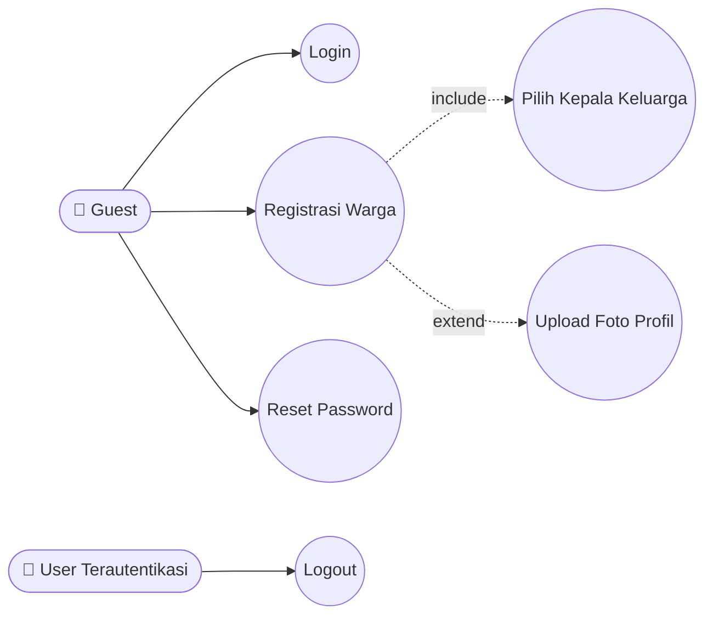
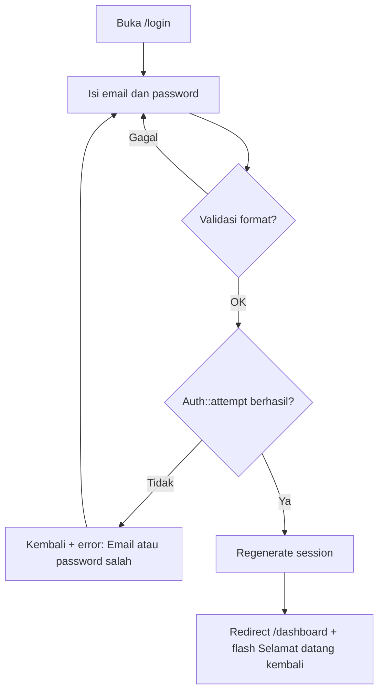
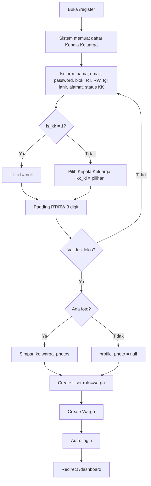
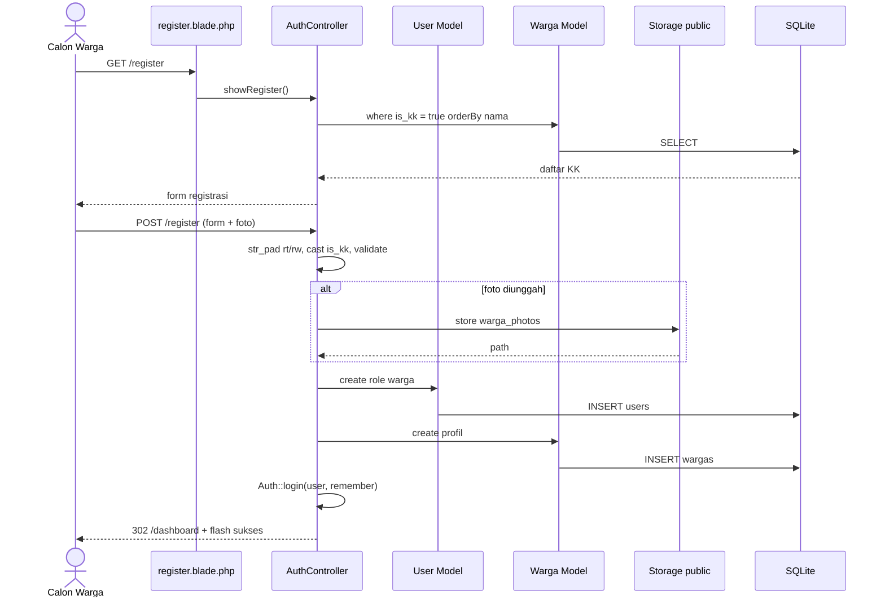
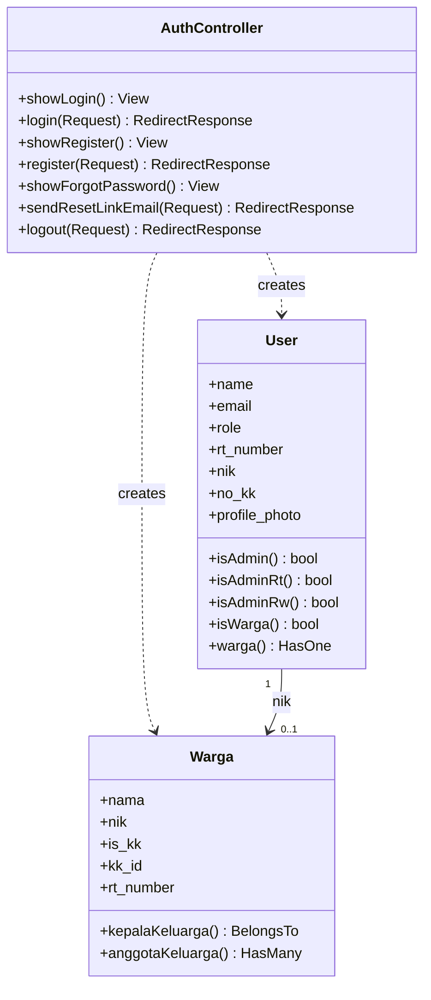
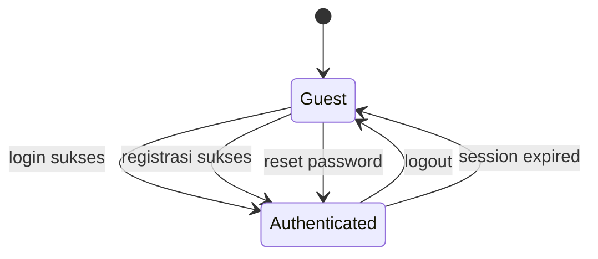

# 🔐 AUTENTIKASI

> Login, registrasi warga mandiri, reset password, dan logout.

## 1. Ringkasan
Modul autentikasi berbasis **session Laravel** (`Auth::attempt` + remember me). Warga baru dapat mendaftar sendiri; proses registrasi **membuat dua record sekaligus**: akun login (`users`) dan profil kependudukan (`wargas`). Akun admin dibuat via seeder/tinker (tidak ada registrasi admin dari UI).

## 2. Aktor & Hak Akses
| Aktor | Aksi |
|---|---|
| Guest | Lihat cover, login, registrasi, reset password |
| User terautentikasi | Logout |

## 3. File Terkait
| Jenis | Path |
|---|---|
| Controller | `app/Http/Controllers/AuthController.php` |
| Model | `app/Models/User.php`, `app/Models/warga.php` |
| View | `resources/views/cover.blade.php`, `auth/login.blade.php`, `auth/register.blade.php`, `auth/forgot-password.blade.php` |
| Route | `routes/web.php` baris 10–22 |

## 4. Route
| Method | URI | Name | Method Controller |
|---|---|---|---|
| GET | `/` | — | view `cover` |
| GET | `/login` | `login` | `showLogin` |
| POST | `/login` | — | `login` |
| GET | `/register` | `register` | `showRegister` |
| POST | `/register` | — | `register` |
| GET | `/forgot-password` | `password.request` | `showForgotPassword` |
| POST | `/forgot-password` | `password.email` | `sendResetLinkEmail` |
| POST | `/logout` | `logout` | `logout` |

## 5. Aturan Bisnis
1. **Login** memakai email + password, selalu `remember = true`, session di-regenerate setelah sukses, redirect ke `intended` atau `/dashboard`.
2. **Registrasi**:
   - `rt_number` & `rw_number` di-padding 3 digit (`6` → `006`).
   - RT wajib salah satu `006–010`.
   - Role otomatis `warga`.
   - Jika `is_kk = 0`, user wajib memilih Kepala Keluarga (`kk_id`) dari daftar warga `is_kk = true`.
   - Foto profil (opsional) disimpan di `storage/app/public/warga_photos`, path yang sama dipakai di `users` dan `wargas`.
   - Setelah sukses → **auto login** → dashboard.
3. **Reset password** (kondisi saat ini): user memasukkan email + password baru + konfirmasi; jika email ada, password langsung diganti lalu auto login.
4. **Logout**: invalidate session + regenerate CSRF token → redirect `/`.

## 6. Use Case Diagram

## 7. Flowchart

### 7.1 Login

### 7.2 Registrasi

## 8. Sequence Diagram — Registrasi

## 9. Class Diagram

## 10. State Diagram — Sesi Pengguna

## 11. Validasi
| Field (register) | Rule |
|---|---|
| name | required, string, max 255 |
| email | required, email, unique:users |
| password | required, min 6, confirmed |
| blok_rumah | required, max 50 |
| tanggal_lahir | required, date |
| rt_number | required, size 3, in 006–010 |
| rw_number | required, size 3 |
| is_kk | required, boolean |
| kk_id | nullable, exists:wargas,id |
| address | required |
| gender | nullable, in L,P |
| profile_photo | nullable, image jpg/jpeg/png, max 2 MB |

## 12. Known Issues & Pengembangan Lanjutan
| # | Isu | Rekomendasi |
|---|---|---|
| 🔴 1 | Reset password **tanpa token/email verifikasi** — account takeover | Gunakan `Password::sendResetLink` + tabel `password_reset_tokens`, atau OTP WhatsApp |
| 🟠 2 | Tidak ada rate-limit login | Tambah `throttle:5,1` pada `POST /login` |
| 🟡 3 | Route guest tidak memakai middleware `guest` (user login bisa buka /login) | Bungkus dengan `Route::middleware('guest')` |
| 🟡 4 | Registrasi tidak mencegah duplikasi NIK | Tambah `unique:wargas,nik` |
| 🟢 5 | `APP_NAME` masih `Laravel` | Ubah ke `NexaNest` |
