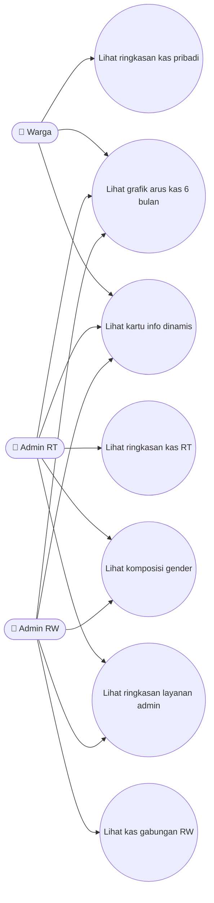
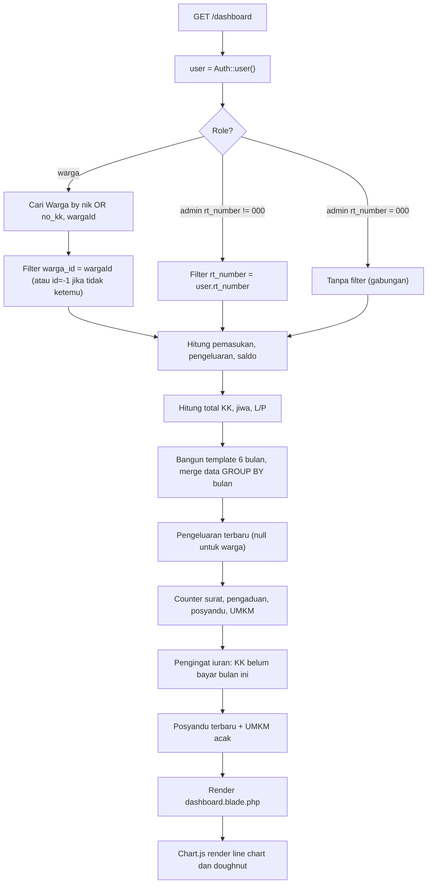
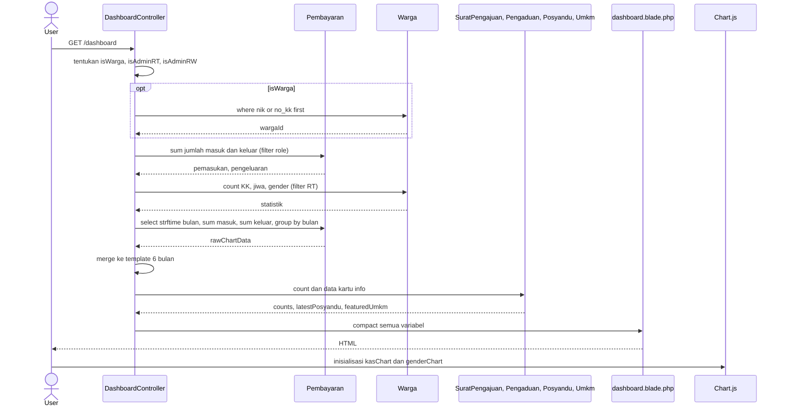
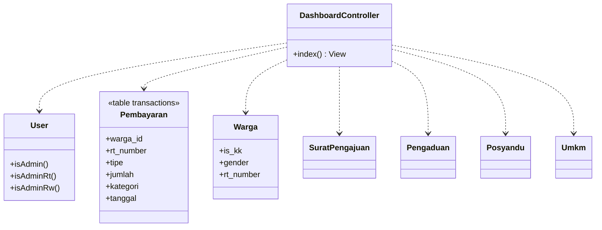

# 📊 DASHBOARD

> Halaman beranda multi-role: ringkasan kas, statistik warga, grafik arus kas 6 bulan, komposisi gender, dan kartu info dinamis.

## 1. Ringkasan
Satu URL (`/dashboard`) yang **menampilkan konten berbeda tergantung role**. Semua angka dihitung *on-the-fly* dari tabel `transactions`, `wargas`, `surat_pengajuans`, `pengaduans`, `posyandus`, `umkms`. Sidebar navigasi di halaman ini juga **role-aware**.

## 2. Aktor & Cakupan Data
| Aktor | Kas (Pemasukan/Pengeluaran/Saldo) | Statistik Warga | Grafik | Ringkasan Admin | Menu Sidebar |
|---|---|---|---|---|---|
| **Warga** | Hanya pembayaran miliknya (`warga_id`) | Semua (agregat) | Pembayaran miliknya | ❌ | Dashboard, Riwayat Iuran Saya, Layanan |
| **Admin RT** | Kas RT-nya (`rt_number`) | Warga RT-nya | Kas RT-nya | ✅ | + Data Warga, Transaksi Kas, Laporan Bulanan, Laporan Iuran |
| **Admin RW** | Gabungan seluruh RT | Seluruh RW | Gabungan | ✅ | sama seperti Admin RT, cakupan seluruh RW |
| **Bendahara** | Gabungan | Seluruh | Gabungan | ❌ | seperti Admin |

## 3. File Terkait
| Jenis | Path |
|---|---|
| Controller | `app/Http/Controllers/DashboardController.php` |
| View | `resources/views/dashboard.blade.php` (sidebar + konten + Chart.js) |
| Model | `Pembayaran`, `Warga`, `User`, `SuratPengajuan`, `Pengaduan`, `Posyandu`, `Umkm` |

## 4. Route
| Method | URI | Name | Controller |
|---|---|---|---|
| GET | `/dashboard` | `dashboard` | `DashboardController@index` (middleware `auth`) |

## 5. Komponen & Aturan Perhitungan
| # | Komponen | Sumber & Rumus |
|---|---|---|
| 1 | **Total Pemasukan** | `SUM(jumlah) WHERE tipe='masuk'` + filter role |
| 2 | **Total Pengeluaran** | `SUM(jumlah) WHERE tipe='keluar'` + filter role |
| 3 | **Saldo Kas** | Pemasukan − Pengeluaran |
| 4 | **Total Warga (Jiwa)** | `COUNT(wargas)` (+ filter RT untuk Admin RT) |
| 5 | **Total KK** | `COUNT WHERE is_kk = true` |
| 6 | **Grafik Arus Kas** (line) | 6 bulan terakhir; template bulan diisi 0 lalu di-merge dengan hasil `GROUP BY strftime('%Y-%m', tanggal)` |
| 7 | **Komposisi Gender** (doughnut) | `COUNT gender='L'` vs `gender='P'` |
| 8 | **Ringkasan Admin** | Jumlah pengajuan surat (filter RT untuk Admin RT), pengaduan, jadwal posyandu, UMKM + jumlah Admin RW/RT |
| 9 | **Pengingat Iuran** | `unpaidKK = totalKK − COUNT(DISTINCT warga_id)` pembayaran kategori `%Iuran%` bulan berjalan |
| 10 | **Info Posyandu** | `Posyandu` dengan `tanggal` terbaru |
| 11 | **Pengeluaran Terbaru** | Transaksi `keluar` terbaru (disembunyikan untuk warga) |
| 12 | **UMKM Pilihan** | `Umkm::inRandomOrder()->first()` |

> [!IMPORTANT]
> Query grafik memakai `strftime()` (**SQLite-only**). Pernah terjadi bug: `DATE_FORMAT` (MySQL) gagal diam-diam di `try/catch` sehingga grafik kosong. Lihat [role.md §6](./role.md#6-kompatibilitas-database-sqlite-️).

## 6. Use Case Diagram

## 7. Flowchart

## 8. Sequence Diagram

## 9. Class Diagram

## 10. Variabel yang Dikirim ke View
`user, pemasukan, pengeluaran, saldo, totalKK, totalJiwa, chartData, maleCount, femaleCount, latestExpenseAmount, latestExpenseDate, newFeatureCounts, totalAdminRT, totalAdminRW, unpaidKK, totalKKForReminder, paidThisMonth, latestPosyandu, featuredUmkm, isWarga, isAdminRT, isAdminRW`

> Jika menambah/mengganti variabel, pastikan **semua** dipakai di `compact()` dan view tetap aman bila nilainya `null`.

## 11. Known Issues & Pengembangan Lanjutan
| # | Isu | Rekomendasi |
|---|---|---|
| 🟡 1 | `strftime` tidak portable | Agregasi di PHP (pola `PembayaranController@index`) |
| 🟡 2 | Counter pengaduan/posyandu/UMKM tidak difilter per RT untuk Admin RT | Terapkan filter `rt_number` / `whereHas('user')` |
| 🟡 3 | `try/catch` menelan error tanpa log | Tambahkan `Log::warning($e->getMessage())` |
| 🟡 4 | Statistik gender untuk warga menampilkan agregat seluruh RW | Pertimbangkan filter RT warga atau sembunyikan |
| 🟢 5 | `DashboardController` menghitung role sendiri (`role === 'admin' && rt_number === '000'`) | Ganti dengan helper `isAdminRw()` / `isAdminRt()` |
| 🟢 6 | Sidebar didefinisikan di `dashboard.blade.php`, bukan di layout | Ekstrak ke `partials/sidebar.blade.php` agar konsisten di semua halaman |
