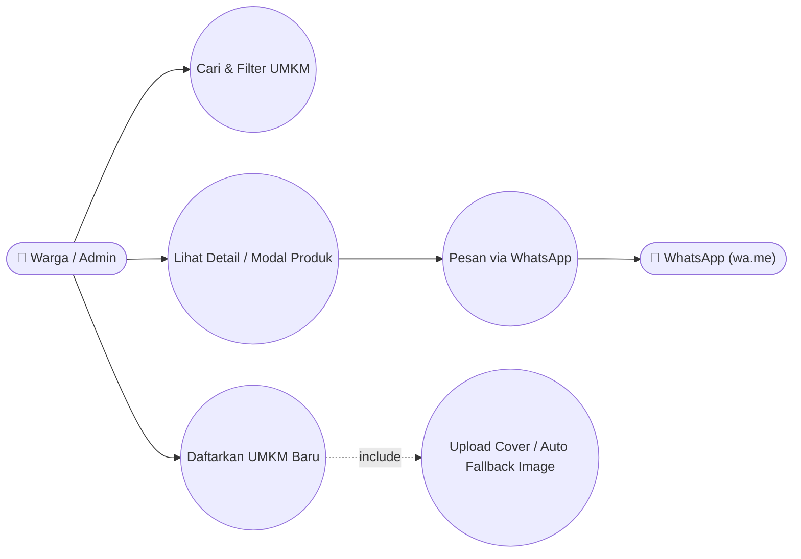
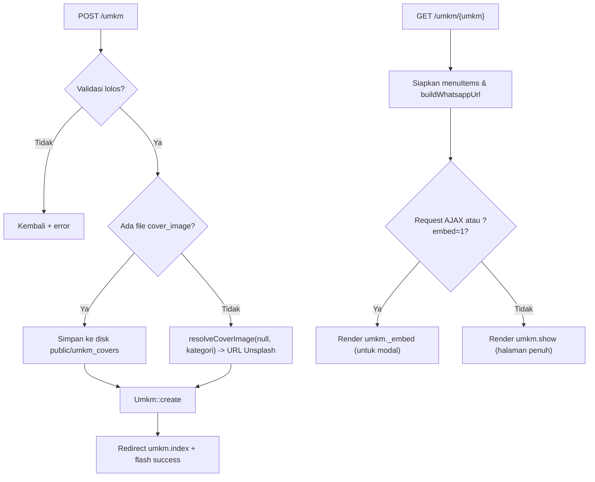
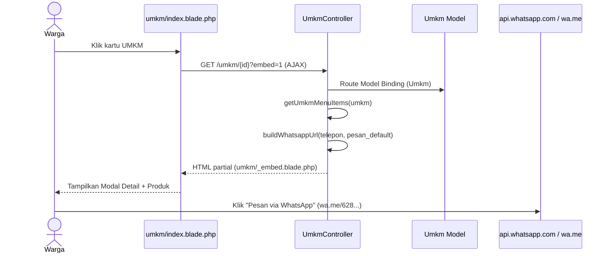
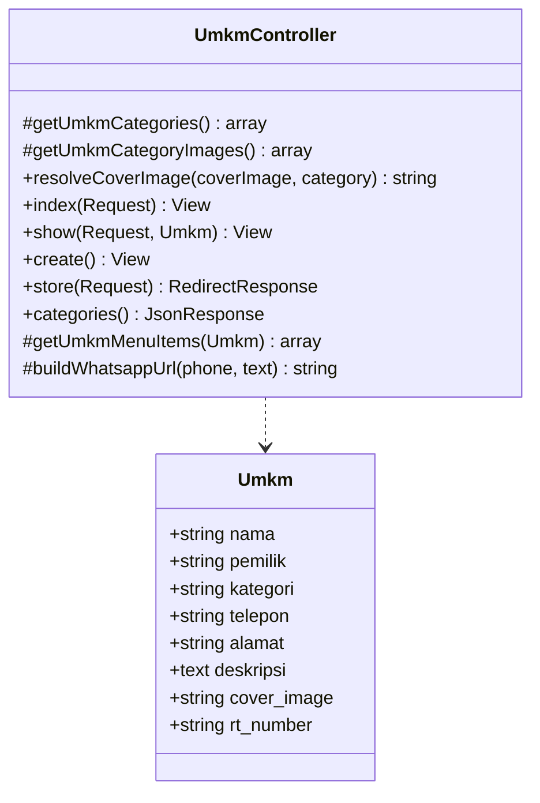

# 🏪 DIREKTORI_UMKM

> Katalog usaha mikro warga RW 018 dengan pencarian, filter kategori, modal/halaman detail produk unggulan, fallback gambar otomatis, dan tombol order langsung via WhatsApp.

## 1. Ringkasan
Modul Direktori UMKM mempromosikan usaha milik warga RW 018 (RT 006–010). Fitur utamanya:
- Pencarian kata kunci (`q`) di kolom `nama`, `pemilik`, `kategori`, `alamat`, `deskripsi`.
- Filter berdasarkan 6 kategori standar (`Jasa`, `Kerajinan`, `Makanan & Minuman`, `Jasa/Service`, `Kuliner`, `Perdagangan`).
- **Fallback Cover Image Otomatis**: jika pengguna tidak mengunggah gambar cover, sistem otomatis menetapkan foto Unsplash yang sesuai dengan kategori usaha (`resolveCoverImage`).
- **Detail & Embed Modal**: mendukung tampilan halaman penuh (`/umkm/{umkm}`) maupun partial modal via AJAX/`?embed=1` (`umkm/_embed.blade.php`) lengkap dengan katalog item contoh per kategori dan tautan order **WhatsApp (`wa.me`)** yang sudah dinormalisasi ke kode negara `62`.

## 2. Aktor & Hak Akses
| Aktor | Jelajahi & Order WA | Daftarkan UMKM Baru |
|---|---|---|
| Warga | ✅ | ✅ |
| Admin RT | ✅ | ✅ |
| Admin RW / Bendahara | ✅ | ✅ |

## 3. File Terkait
| Jenis | Path |
|---|---|
| Controller | [`app/Http/Controllers/UmkmController.php`](file:///c:/laragon/www/iuran-anggi/app/Http/Controllers/UmkmController.php) |
| Model | [`app/Models/Umkm.php`](file:///c:/laragon/www/iuran-anggi/app/Models/Umkm.php) (tabel `umkms`) |
| View | [`resources/views/umkm/index.blade.php`](file:///c:/laragon/www/iuran-anggi/resources/views/umkm/index.blade.php), [`create.blade.php`](file:///c:/laragon/www/iuran-anggi/resources/views/umkm/create.blade.php), [`show.blade.php`](file:///c:/laragon/www/iuran-anggi/resources/views/umkm/show.blade.php), [`_embed.blade.php`](file:///c:/laragon/www/iuran-anggi/resources/views/umkm/_embed.blade.php) |
| Seeder | [`database/seeders/UmkmSeeder.php`](file:///c:/laragon/www/iuran-anggi/database/seeders/UmkmSeeder.php) |
| Test | [`tests/Unit/UmkmFallbackImageTest.php`](file:///c:/laragon/www/iuran-anggi/tests/Unit/UmkmFallbackImageTest.php) |
| Storage | `storage/app/public/umkm_covers/` |

## 4. Route
| Method | URI | Name | Aksi |
|---|---|---|---|
| GET | `/umkm?q=&kategori=` | `umkm.index` | Katalog UMKM + statistik + featured items |
| GET | `/umkm/create` | `umkm.create` | Form tambah UMKM |
| POST | `/umkm` | `umkm.store` | Simpan UMKM baru |
| GET | `/umkm/{umkm}` (`?embed=1`) | `umkm.show` | Halaman detail atau partial `_embed` (AJAX/modal) |
| GET | `/umkm/categories` | `umkm.categories` | Endpoint JSON daftar kategori |

> [!WARNING]
> Di [`routes/web.php`](file:///c:/laragon/www/iuran-anggi/routes/web.php#L54-L55), `Route::resource('umkm')->only(['index','show','create','store'])` didefinisikan **sebelum** `Route::get('/umkm/categories')`. Karena `/umkm/{umkm}` menggunakan implicit model binding, request ke `/umkm/categories` dapat tertangkap oleh `umkm.show` terlebih dahulu dan menghasilkan 404 jika tidak diletakkan di atas `Route::resource`. Lihat bagian *Known Issues*.

## 5. Aturan Bisnis
1. **Kategori Resmi**: `Jasa`, `Kerajinan`, `Makanan & Minuman`, `Jasa/Service`, `Kuliner`, `Perdagangan`.
2. **Resolusi Gambar Cover (`resolveCoverImage`)**:
   - Jika upload file `cover_image` → simpan ke `storage/app/public/umkm_covers`.
   - Jika kosong → pilih URL Unsplash berdasarkan pencocokan kata kunci kategori (`jasa`, `kerajinan`, `makan`/`kuliner`, `dagang`/`perdagangan`, atau default).
3. **Normalisasi Nomor WhatsApp (`buildWhatsappUrl`)**:
   - Hapus karakter selain angka dan `+`, buang `+` di depan.
   - Jika diawali `0` → ganti menjadi `62` (contoh: `0812...` → `https://wa.me/62812...?text=...`).
4. **Menu Unggulan Otomatis (`getUmkmMenuItems`)**: menghasilkan 3 item katalog beserta harga & foto per kategori usaha untuk ditampilkan di halaman detail/modal.

## 6. Use Case Diagram

## 7. Flowchart — Pendaftaran & Penampilan UMKM

## 8. Sequence Diagram — Lihat Detail & Order WhatsApp

## 9. Class Diagram

## 10. Validasi
| Field | Rule |
|---|---|
| `nama` | `required\|string\|max:255` |
| `pemilik` | `nullable\|string\|max:255` |
| `kategori` | `required\|string\|in:Jasa,Kerajinan,Makanan & Minuman,Jasa/Service,Kuliner,Perdagangan` |
| `telepon` | `nullable\|string\|max:50` |
| `alamat` | `nullable\|string\|max:255` |
| `deskripsi` | `nullable\|string\|max:2000` |
| `rt_number` | `required\|string\|in:006,007,008,009,010` |
| `cover_image` | `nullable\|image\|mimes:jpeg,png,jpg,gif\|max:2048` |

## 11. Known Issues & Pengembangan Lanjutan
| # | Isu | Rekomendasi |
|---|---|---|
| 🟡 1 | Route `/umkm/categories` diletakkan setelah `Route::resource('umkm')` sehingga tertimpa `/umkm/{umkm}` | Pindahkan `Route::get('/umkm/categories', ...)` ke **atas** `Route::resource('umkm', ...)` |
| 🟡 2 | Belum ada relasi kepemilikan (`user_id` / `warga_id`) serta fitur edit & hapus UMKM | Tambahkan `user_id` + kebijakan edit/hapus oleh pemilik atau Admin |
| 🟡 3 | Daftar produk (`getUmkmMenuItems`) masih statis per kategori di controller | Buat tabel `umkm_products` agar pemilik usaha bisa mengelola menu & harga riil |
| 🟢 4 | Belum ada filter berdasarkan `rt_number` di halaman katalog | Tambahkan dropdown filter RT di `umkm/index.blade.php` |
