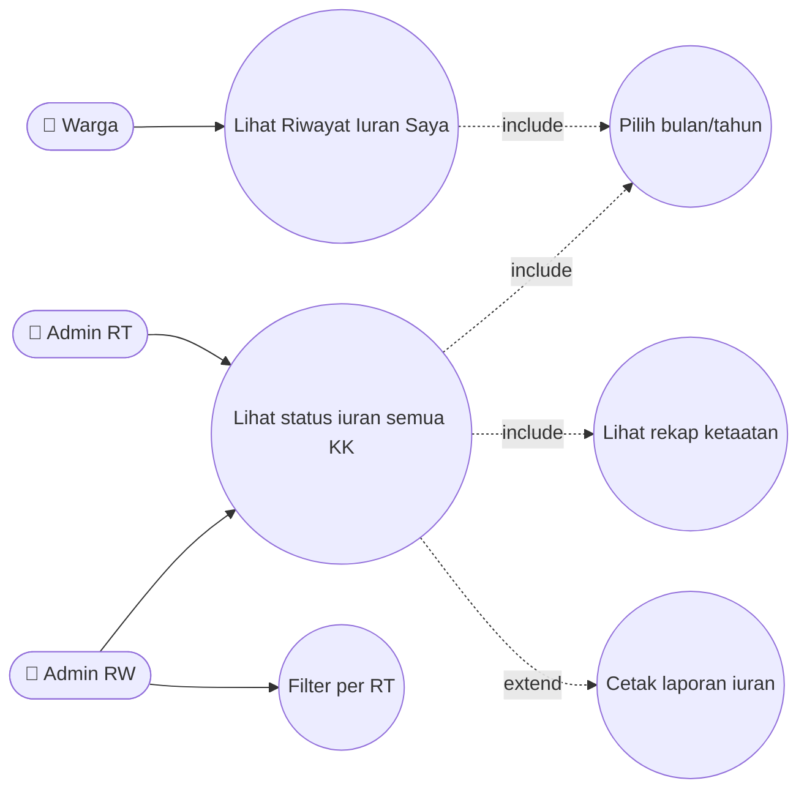
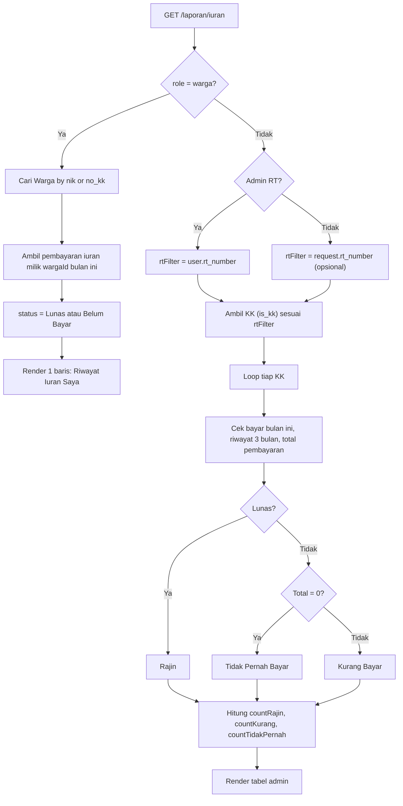
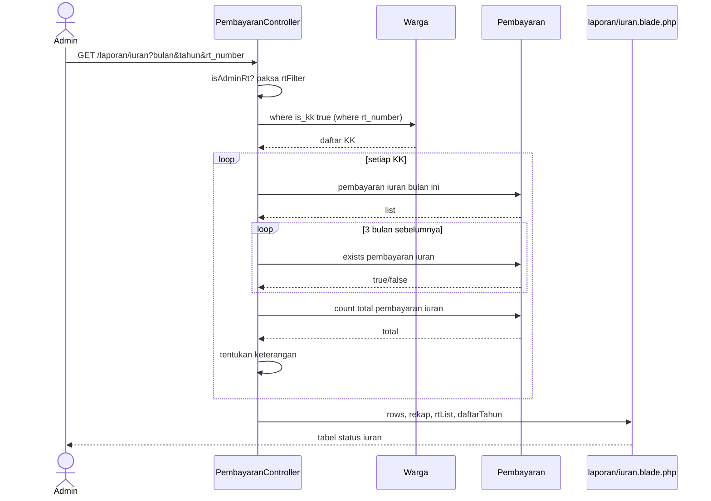
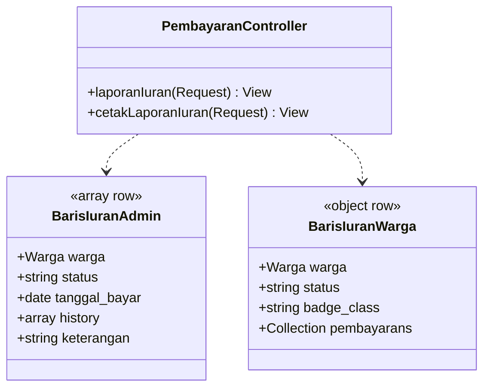
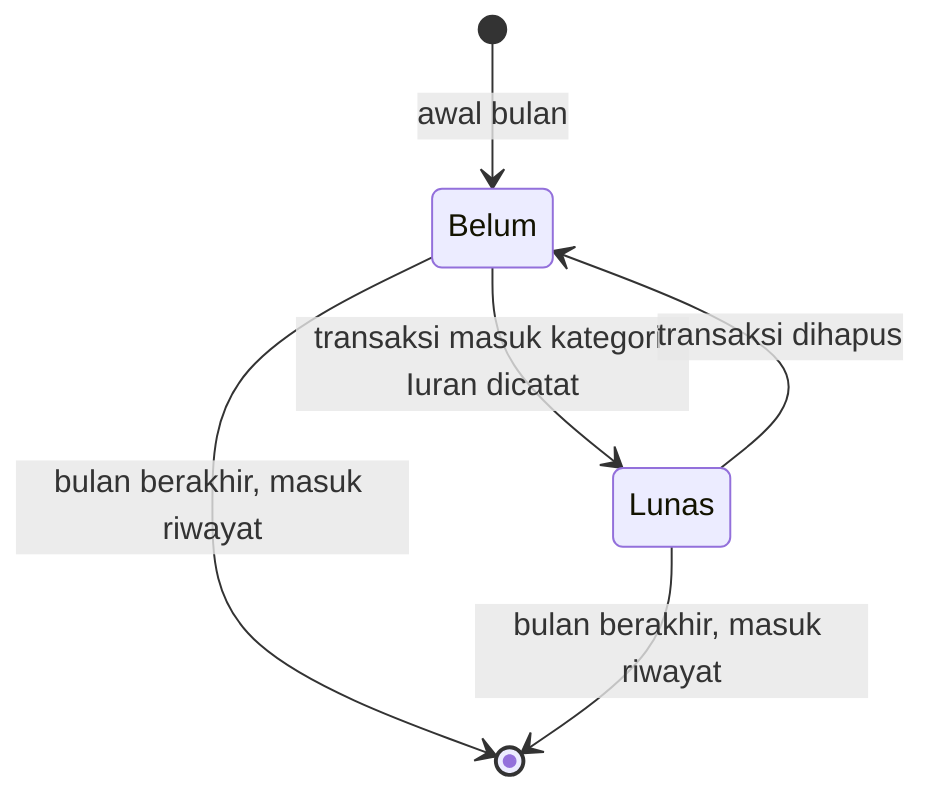

# 🧾 LAPORAN_IURAN

> Status pembayaran iuran per Kepala Keluarga, riwayat 3 bulan, dan klasifikasi ketaatan bayar. Untuk warga: "Riwayat Iuran Saya".

## 1. Ringkasan
Satu route dengan dua perilaku:
- **Warga** → hanya melihat **status iuran miliknya** pada bulan terpilih (Lunas / Belum Bayar) beserta daftar pembayarannya.
- **Admin** → tabel seluruh KK (difilter RT) berisi status bulan ini, tanggal bayar, riwayat 3 bulan sebelumnya, dan klasifikasi **Rajin / Kurang Bayar / Tidak Pernah Bayar**, plus rekap jumlah tiap klasifikasi.

Pembayaran dianggap iuran bila `tipe = 'masuk'` **dan** `kategori LIKE '%Iuran%'`.

## 2. Aktor & Hak Akses
| Aktor | Lihat | Cakupan | Cetak |
|---|---|---|---|
| Warga | ✅ "Riwayat Iuran Saya" | Hanya dirinya | ❌ |
| Admin RT | ✅ | KK di RT-nya (filter dipaksa) | ✅ |
| Admin RW / Bendahara | ✅ | Semua KK + dropdown filter RT 006–010 | ✅ |

## 3. File Terkait
| Jenis | Path |
|---|---|
| Controller | `PembayaranController@laporanIuran`, `@cetakLaporanIuran` |
| View | `resources/views/laporan/iuran.blade.php`, `laporan/cetak_iuran.blade.php` |
| Model | `Pembayaran`, `Warga` |

## 4. Route
| Method | URI | Name | Parameter |
|---|---|---|---|
| GET | `/laporan/iuran` | `laporan.iuran` | `bulan`, `tahun`, `rt_number` (admin RW) |
| GET | `/laporan/cetak-iuran` | `laporan.cetak_iuran` | `bulan`, `tahun`, `rt_number` |

## 5. Aturan Bisnis
1. **Identifikasi warga login**: `Warga::where('nik', user.nik)->orWhere('no_kk', user.no_kk)->first()`; jika tidak ketemu → `wargaId = -1` (hasil kosong).
2. **Status bulan terpilih**: `Lunas` jika ada ≥1 pembayaran iuran pada bulan & tahun tsb; selain itu `Belum` (admin) / `Belum Bayar` (warga).
3. **Riwayat**: 3 bulan sebelum bulan terpilih, masing-masing `paid: true/false`.
4. **Klasifikasi** (admin):

   | Kondisi | Keterangan |
   |---|---|
   | Lunas bulan terpilih | **Rajin** |
   | Belum & total pembayaran iuran sepanjang masa = 0 | **Tidak Pernah Bayar** |
   | Belum & pernah bayar sebelumnya | **Kurang Bayar** |
5. Admin RT: `rtFilter` **selalu ditimpa** dengan RT miliknya (tidak bisa melihat RT lain walau memanipulasi query string).
6. Hanya KK (`is_kk = true`) yang dihitung sebagai wajib iuran.

## 6. Use Case Diagram

## 7. Flowchart

## 8. Sequence Diagram — Admin

## 9. Class Diagram

## 10. State Diagram — Status Iuran KK per Bulan

## 11. Known Issues & Pengembangan Lanjutan
| # | Isu | Rekomendasi |
|---|---|---|
| 🟠 1 | **N+1 query**: per KK ±5 query (100 KK ≈ 500 query) | Ambil semua pembayaran iuran 4 bulan sekali, `groupBy('warga_id')` di PHP |
| 🟡 2 | Deteksi iuran berbasis string `LIKE '%Iuran%'` (rapuh) | Kolom `is_iuran` atau enum kategori |
| 🟡 3 | Lookup warga `nik OR no_kk` bisa memilih anggota keluarga lain | Utamakan `nik`, fallback KK dengan `is_kk = true` |
| 🟡 4 | Logika `laporanIuran` & `cetakLaporanIuran` duplikat | Ekstrak ke service |
| 🟢 5 | Tidak ada nominal iuran standar (target vs realisasi) | Tabel `pengaturan_iuran` per RT |
| 🟢 6 | Belum ada pengingat otomatis ke KK yang belum bayar | Notifikasi WhatsApp terjadwal (`schedule`) |
