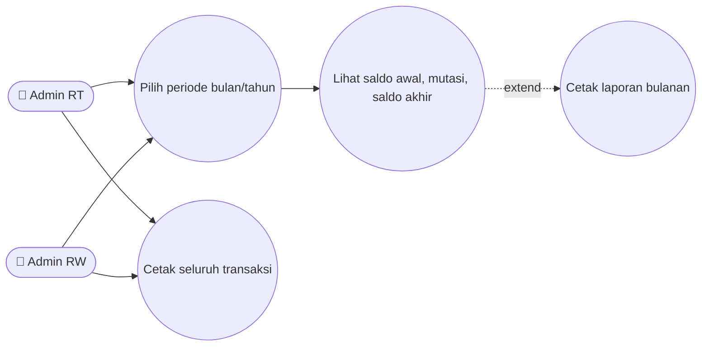
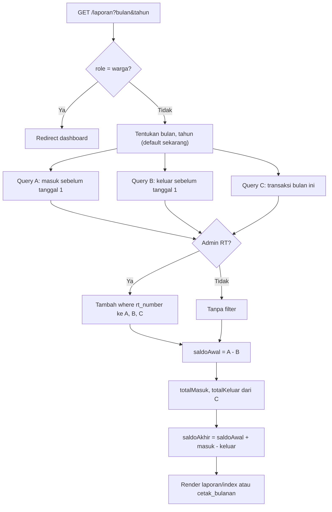
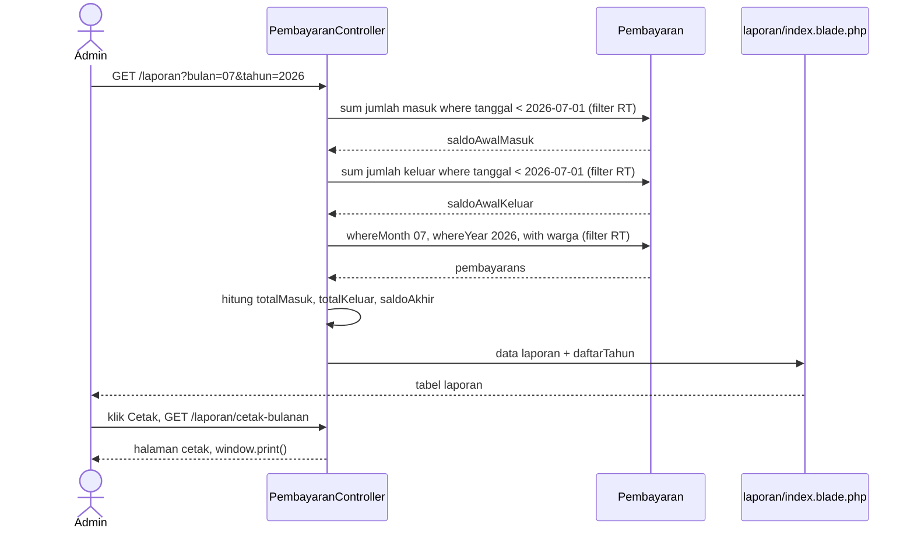
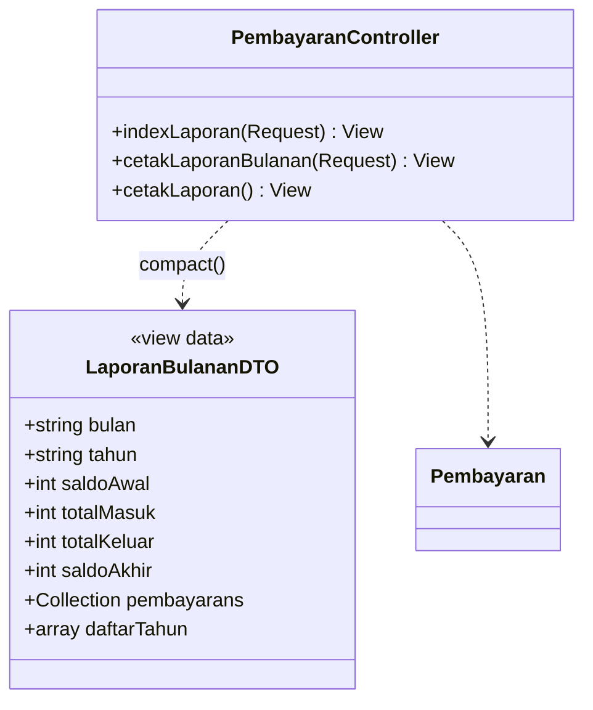

# 📑 LAPORAN_KEUANGAN

> Laporan kas bulanan dengan saldo awal, mutasi bulan berjalan, dan saldo akhir — siap cetak.

## 1. Ringkasan
Pengurus memilih **bulan & tahun**, lalu sistem menghitung:
- **Saldo Awal** = total masuk − total keluar **sebelum** tanggal 1 bulan terpilih
- **Mutasi** = seluruh transaksi di bulan terpilih
- **Saldo Akhir** = Saldo Awal + Total Masuk − Total Keluar

Tersedia versi layar (`laporan.index`) dan versi cetak (`laporan.cetak_bulanan`, layout ramah printer / Save as PDF dari browser).

## 2. Aktor & Hak Akses
| Aktor | Akses | Cakupan |
|---|---|---|
| Warga | ❌ redirect dashboard | — |
| Admin RT | ✅ | Kas RT-nya |
| Admin RW / Bendahara | ✅ | Kas gabungan semua RT + Kas Umum RW (`000`) |

## 3. File Terkait
| Jenis | Path |
|---|---|
| Controller | `PembayaranController@indexLaporan`, `@cetakLaporanBulanan`, `@cetakLaporan` |
| View | `resources/views/laporan/index.blade.php`, `laporan/cetak_bulanan.blade.php`, `pembayaran/cetak.blade.php` |
| Model | `Pembayaran` (tabel `transactions`) |

## 4. Route
| Method | URI | Name | Parameter |
|---|---|---|---|
| GET | `/laporan` | `laporan.index` | `bulan` (01–12, default bulan ini), `tahun` (default tahun ini) |
| GET | `/laporan/cetak-bulanan` | `laporan.cetak_bulanan` | `bulan`, `tahun` |
| GET | `/laporan/cetak` | `laporan.cetak` | — (seluruh transaksi, urut tanggal asc) |

## 5. Aturan Bisnis
1. Filter role (Admin RT → `rt_number`) diterapkan pada **ketiga** query: saldo awal masuk, saldo awal keluar, dan transaksi bulan ini.
2. Pilihan tahun: tahun ini mundur 5 tahun (`range(date('Y'), date('Y') - 5)`).
3. Transaksi bulan ini diurutkan `tanggal ASC` dan eager-load relasi `warga`.
4. Cetak memakai view tanpa sidebar, dipicu `window.print()` di browser.

## 6. Use Case Diagram

## 7. Flowchart

## 8. Sequence Diagram

## 9. Class Diagram

## 10. Rumus
$$\text{Saldo Awal} = \sum_{t < \text{tgl 1}} \text{masuk} - \sum_{t < \text{tgl 1}} \text{keluar}$$
$$\text{Saldo Akhir} = \text{Saldo Awal} + \sum_{\text{bulan ini}} \text{masuk} - \sum_{\text{bulan ini}} \text{keluar}$$

## 11. Known Issues & Pengembangan Lanjutan
| # | Isu | Rekomendasi |
|---|---|---|
| 🟡 1 | Logika `indexLaporan` & `cetakLaporanBulanan` duplikat | Ekstrak ke service `LaporanKasService::bulanan($user, $bulan, $tahun)` |
| 🟡 2 | Parameter `bulan`/`tahun` tidak divalidasi (input bebas) | Validasi `bulan` 1–12, `tahun` 4 digit; pad bulan 2 digit |
| 🟡 3 | Admin RW tidak bisa memfilter per RT tertentu | Tambah dropdown `rt_number` (seperti Laporan Iuran) |
| 🟢 4 | Cetak bergantung pada print browser | Integrasi `barryvdh/laravel-dompdf` (perlu izin user untuk dependency baru) |
| 🟢 5 | Belum ada ekspor Excel | `maatwebsite/excel` |
