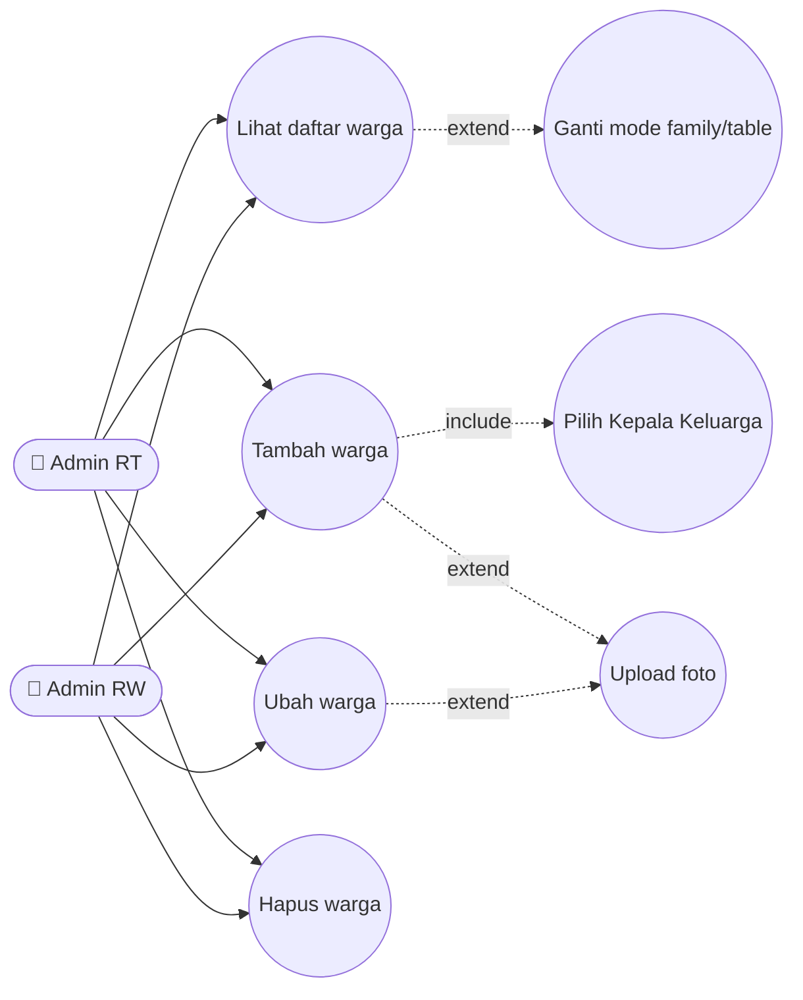
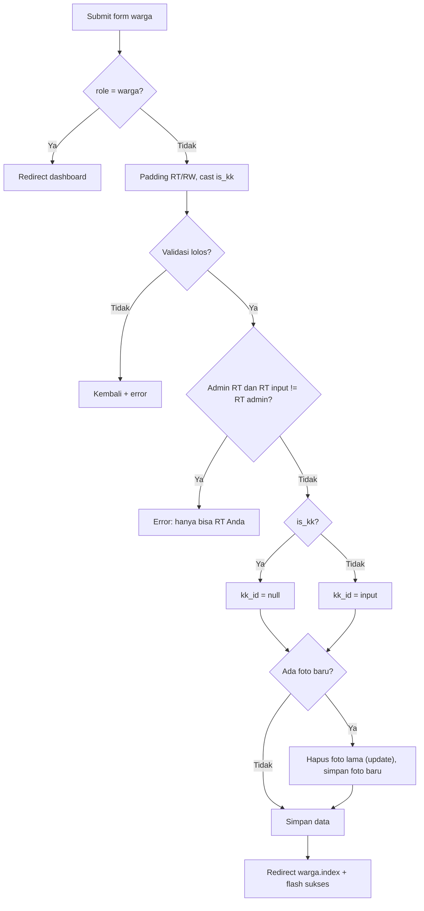
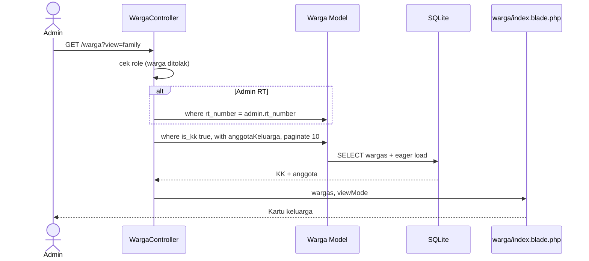
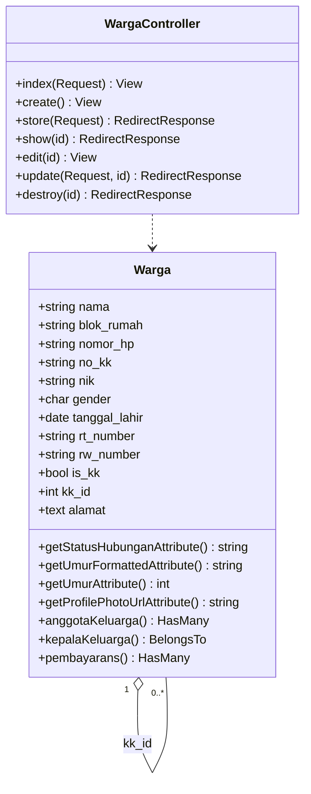
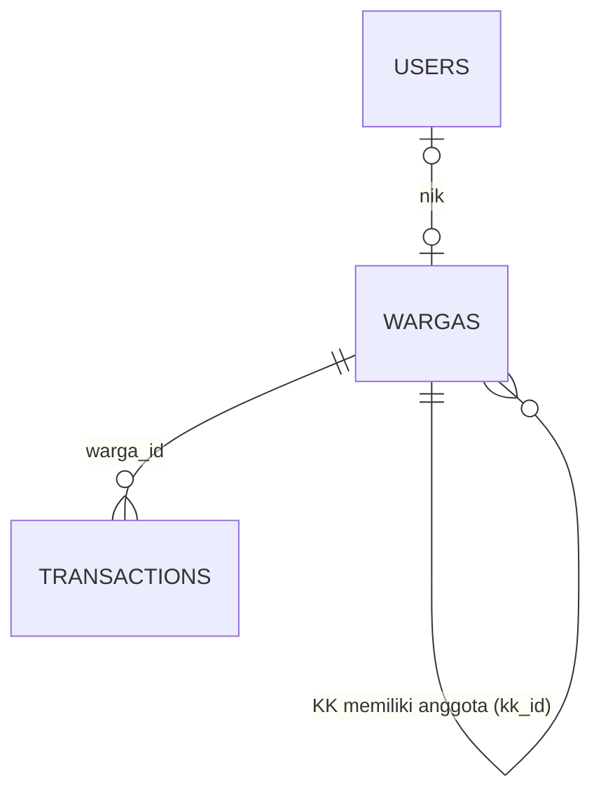

# 👨‍👩‍👧 MANAJEMEN_WARGA

> CRUD data kependudukan dengan struktur Kepala Keluarga (KK) → Anggota Keluarga, dibatasi per RT.

## 1. Ringkasan
Admin mengelola data warga (penduduk) RW 018. Setiap warga memiliki RT/RW, NIK, No. KK, gender, tanggal lahir, foto. Relasi keluarga dibangun dengan **self-reference** `kk_id`: Kepala Keluarga (`is_kk = true`, `kk_id = null`) memiliki banyak anggota (`kk_id = id KK`). Tampilan tersedia dalam dua mode: **family** (kartu per KK berisi anggota) dan **table** (daftar datar).

## 2. Aktor & Hak Akses
| Aktor | Lihat | Tambah | Ubah | Hapus |
|---|---|---|---|---|
| Warga | ❌ (redirect dashboard) | ❌ | ❌ | ❌ |
| Admin RT | ✅ RT-nya | ✅ hanya ke RT-nya | ✅ RT-nya, tidak boleh pindah RT | ✅ RT-nya |
| Admin RW / Bendahara | ✅ semua | ✅ semua RT | ✅ | ✅ |

## 3. File Terkait
| Jenis | Path |
|---|---|
| Controller | `app/Http/Controllers/WargaController.php` |
| Model | `app/Models/warga.php` (class `Warga`, tabel `wargas`) |
| View | `resources/views/warga/index.blade.php`, `create.blade.php`, `edit.blade.php` |
| Seeder | `database/seeders/WargaAestheticSeeder.php`, `FixDataWargaLamaSeeder.php` |
| Storage | `storage/app/public/warga_photos/` |

## 4. Route (`Route::resource('warga')`)
| Method | URI | Name | Aksi |
|---|---|---|---|
| GET | `/warga?view=family\|table` | `warga.index` | Daftar (family: 10/hal, table: 20/hal) |
| GET | `/warga/create` | `warga.create` | Form tambah |
| POST | `/warga` | `warga.store` | Simpan |
| GET | `/warga/{id}` | `warga.show` | Redirect ke index |
| GET | `/warga/{id}/edit` | `warga.edit` | Form ubah |
| PUT/PATCH | `/warga/{id}` | `warga.update` | Perbarui |
| DELETE | `/warga/{id}` | `warga.destroy` | Hapus (+ hapus foto) |

## 5. Aturan Bisnis
1. RT/RW di-padding 3 digit sebelum validasi; RT wajib `006–010`.
2. Jika `is_kk = 1` → `kk_id` dipaksa `null`. Jika `is_kk = 0` → `kk_id` diisi KK pilihan.
3. Dropdown Kepala Keluarga untuk Admin RT hanya berisi KK di RT-nya; saat edit, warga itu sendiri dikecualikan.
4. Admin RT ditolak jika `rt_number` input ≠ RT-nya (store & update).
5. Foto lama dihapus dari disk saat foto baru diunggah atau warga dihapus.
6. Atribut turunan (accessor):
   - `status_hubungan`: `Kepala Keluarga` (is_kk) · `Istri` (P & umur ≥ 18) · `Anak` (lainnya)
   - `umur_formatted`: "X Thn Y Bln"
   - `profile_photo_url`: storage URL / URL eksternal / fallback `ui-avatars.com`
7. Menghapus KK → anggota `kk_id` di-set `null` (FK `onDelete('set null')`).

## 6. Use Case Diagram

## 7. Flowchart — Tambah/Ubah Warga

## 8. Sequence Diagram — Index (mode family)

## 9. Class Diagram

## 10. ER Diagram

## 11. Validasi
| Field | Rule |
|---|---|
| nama | required, max 255 |
| blok_rumah | required, max 50 |
| nomor_hp | nullable, max 20 |
| no_kk, nik | nullable, max 25 |
| gender | nullable, in L,P |
| tanggal_lahir | required, date |
| rt_number | required, size 3, in 006–010 |
| rw_number | required, size 3 |
| is_kk | required, boolean |
| kk_id | nullable, exists:wargas,id |
| alamat | required |
| profile_photo | nullable, image jpg/jpeg/png, max 2 MB |

## 12. Known Issues & Pengembangan Lanjutan
| # | Isu | Rekomendasi |
|---|---|---|
| 🟡 1 | NIK tidak unik | `unique:wargas,nik` (abaikan id saat update) |
| 🟡 2 | Kepala keluarga yang dihapus membuat anggota yatim (`kk_id=null` tapi `is_kk=false`) | Konfirmasi + pindahkan anggota / angkat KK baru |
| 🟡 3 | `status_hubungan` hanya heuristik gender+umur | Tambah kolom `hubungan_keluarga` eksplisit |
| 🟢 4 | Query `is_kk` ditulis 3 variasi (`true`, `1`, `'1'`) | Tambah cast `'is_kk' => 'boolean'` + scope `scopeKepalaKeluarga()` |
| 🟢 5 | File model `warga.php` lowercase | Rename ke `Warga.php` (penting untuk server Linux) |
| 🟢 6 | Belum ada pencarian/filter nama | Tambah input `q` |
