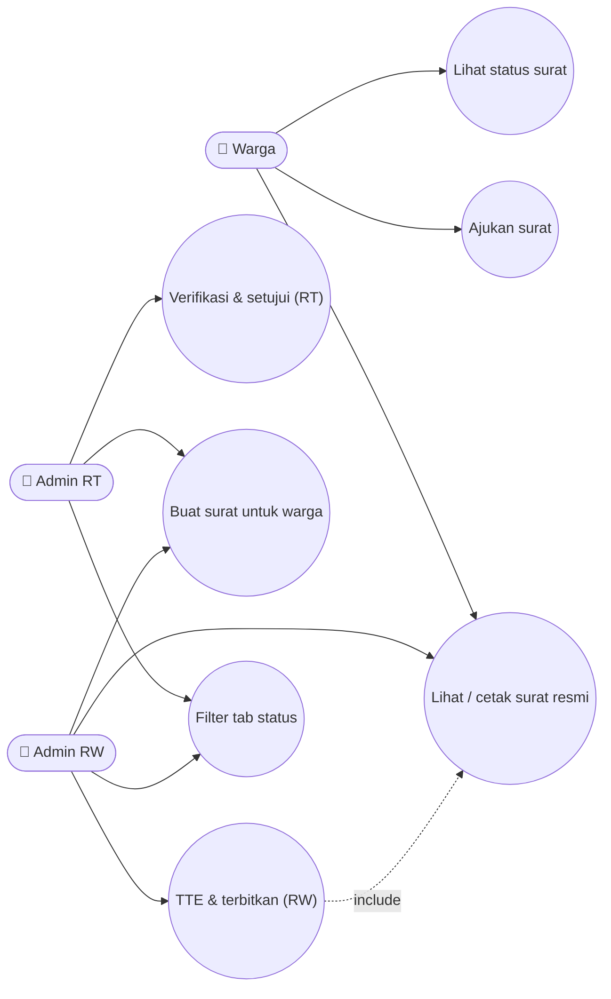
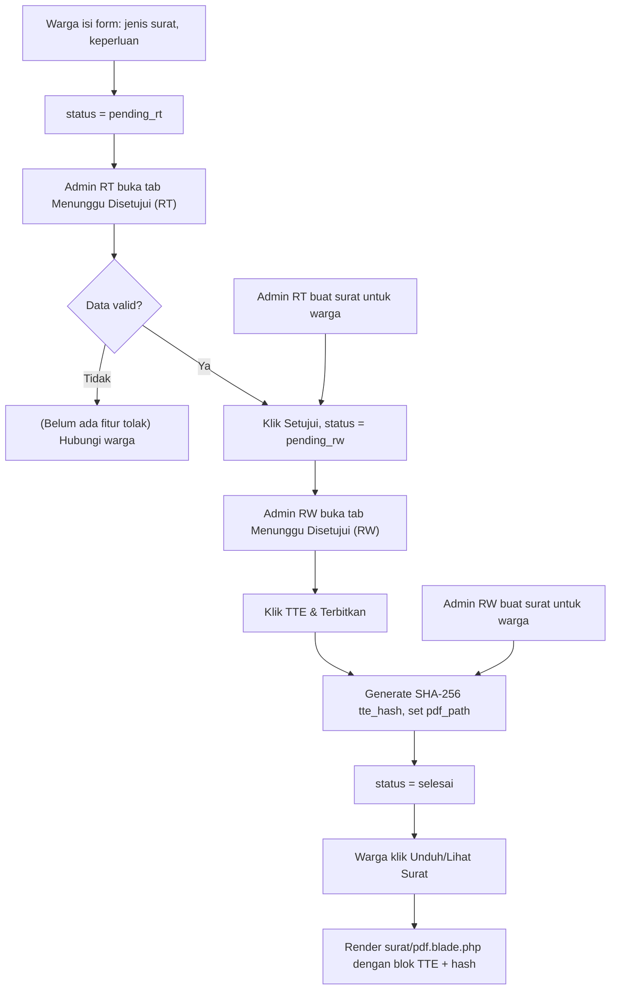
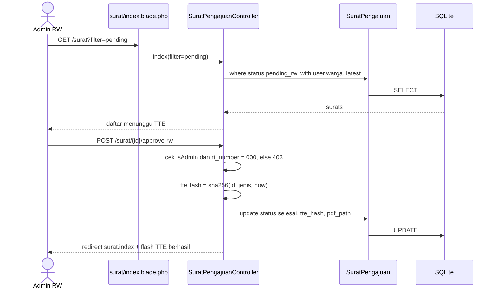
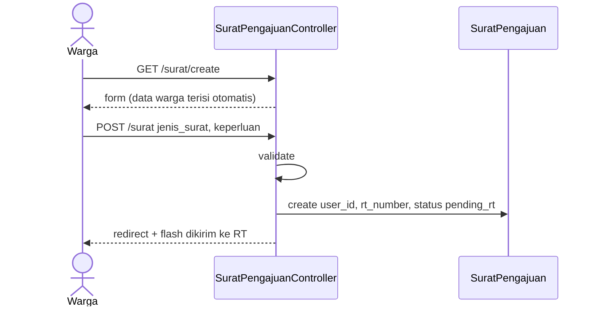
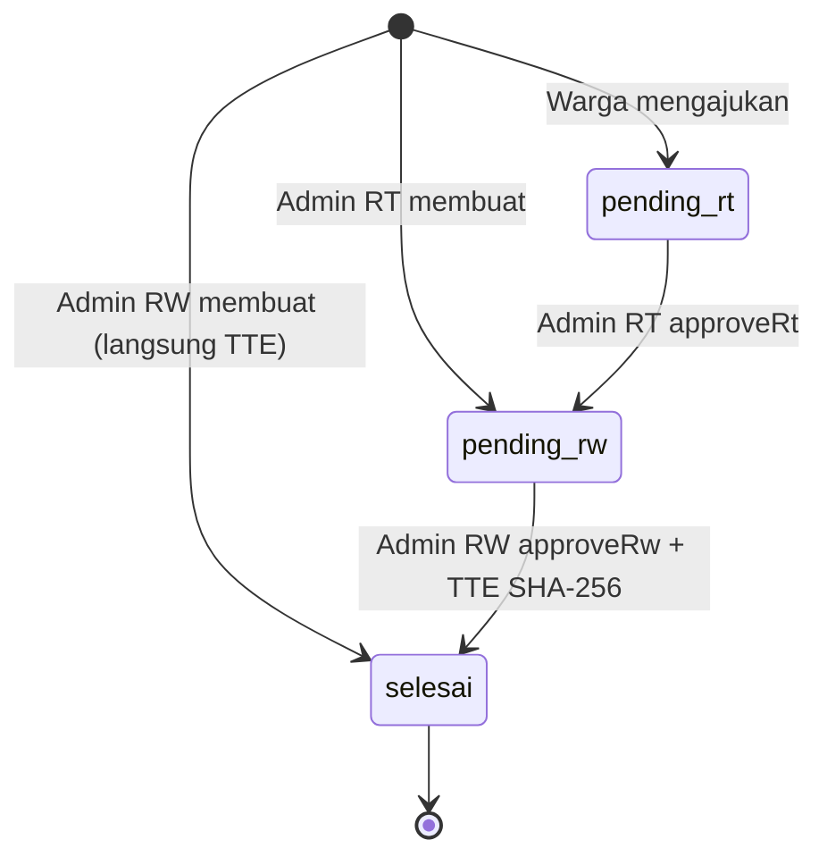
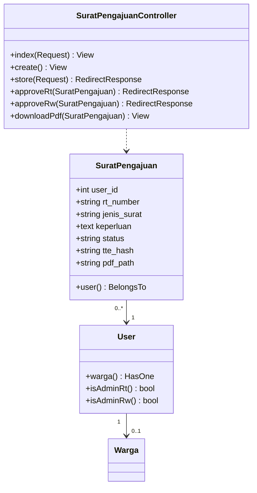

# ✉️ PENERBITAN_SURAT

> Pengajuan surat keterangan secara online dengan persetujuan berjenjang **RT → RW** dan **Tanda Tangan Elektronik (TTE)** berbasis hash SHA-256.

## 1. Ringkasan
Warga mengajukan surat (domisili, SKU, SKTM, pengantar SKCK, pengantar nikah, dll). Admin RT memverifikasi, lalu Admin RW memberikan TTE dan menerbitkan. Surat yang terbit dapat dilihat/dicetak dalam format resmi (kop RW, data pemohon, blok TTE + hash).

Admin juga dapat **membuat surat atas nama warga**:
- Dibuat Admin RT → langsung `pending_rw`
- Dibuat Admin RW → langsung `selesai` + TTE

## 2. Aktor & Hak Akses
| Aktor | Ajukan/Buat | Lihat Daftar | Setujui RT | TTE & Terbitkan | Lihat PDF |
|---|---|---|---|---|---|
| Warga / Bendahara | ✅ untuk diri sendiri → `pending_rt` | Miliknya | ❌ | ❌ | ✅ jika `selesai` |
| Admin RT | ✅ untuk warga RT-nya → `pending_rw` | Surat RT-nya | ✅ | ❌ | ✅ |
| Admin RW | ✅ untuk warga mana pun → `selesai` | Semua RT | ❌ | ✅ | ✅ |

### Tab Filter di Halaman Daftar
| Role | Tab | Status yang ditampilkan |
|---|---|---|
| Admin RW | Semua · **Menunggu Disetujui (RW)** · Sudah Selesai | all · `pending_rw` · `selesai` |
| Admin RT | Semua · **Menunggu Disetujui (RT)** · Menunggu RW · Sudah Selesai | all · `pending_rt` · `pending_rw` · `selesai` |
| Warga | (tanpa tab) | semua miliknya |

## 3. File Terkait
| Jenis | Path |
|---|---|
| Controller | `app/Http/Controllers/SuratPengajuanController.php` |
| Model | `app/Models/SuratPengajuan.php` (tabel `surat_pengajuans`) |
| View | `resources/views/surat/index.blade.php`, `create.blade.php`, `pdf.blade.php` |
| Seeder | `database/seeders/SuratPengajuanSeeder.php` |
| Legacy (jangan dipakai) | `SuratController`, model `Surat`, tabel `surats` |

## 4. Route
| Method | URI | Name | Aksi |
|---|---|---|---|
| GET | `/surat?filter=all\|pending\|pending_rw\|selesai` | `surat.index` | Daftar + tab |
| GET | `/surat/create` | `surat.create` | Form |
| POST | `/surat` | `surat.store` | Simpan pengajuan |
| POST | `/surat/{surat}/approve-rt` | `surat.approve_rt` | Admin RT setujui → `pending_rw` |
| POST | `/surat/{surat}/approve-rw` | `surat.approve_rw` | Admin RW TTE → `selesai` |
| GET | `/surat/{surat}/pdf` | `surat.pdf` | Tampilan surat resmi (status `selesai`) |

## 5. Aturan Bisnis
1. **Jenis surat** (dropdown): Surat Keterangan Domisili, Surat Keterangan Usaha (SKU), Surat Keterangan Tidak Mampu (SKTM), Surat Pengantar Kelakuan Baik (SKCK), Surat Pengantar Pernikahan, dan lainnya sesuai `create.blade.php`.
2. `rt_number` surat = RT pemohon (target user saat dibuat admin; fallback `'006'`).
3. **TTE Hash**:
   - Approve RW: `sha256(id | jenis_surat | now())`
   - Dibuat langsung Admin RW: `sha256(random(10) | jenis_surat | now())`
4. Setelah TTE: `pdf_path = route('surat.pdf', id)`.
5. `approveRt` → `abort(403)` jika bukan admin atau Admin RW. `approveRw` → `abort(403)` jika bukan Admin RW.
6. `downloadPdf` → `abort(403)` jika status ≠ `selesai`.
7. Warga dapat mengajukan hanya jika akun terhubung dengan data `Warga` (tombol submit di-disable bila `$warga` null).

## 6. Use Case Diagram

## 7. Flowchart — Alur End-to-End

## 8. Sequence Diagram — Approve RW (TTE)

## 9. Sequence Diagram — Pengajuan oleh Warga

## 10. State Diagram

## 11. Class Diagram

## 12. Validasi
| Konteks | Field | Rule |
|---|---|---|
| Admin | target_user_id | required, exists:users,id |
| Semua | jenis_surat | required, max 255 |
| Semua | keperluan | required, max 2000 |

## 13. Known Issues & Pengembangan Lanjutan
| # | Isu | Rekomendasi |
|---|---|---|
| 🔴 1 | `downloadPdf` tanpa cek kepemilikan | Izinkan hanya pemilik, Admin RT dengan RT sama, Admin RW |
| 🟠 2 | `approveRt` tidak cek `surat.rt_number == user.rt_number` & status `pending_rt` | Tambah guard |
| 🟠 3 | `approveRw` tidak cek status `pending_rw` (bisa TTE ulang surat selesai → hash berubah) | Tambah guard |
| 🟡 4 | Tidak ada status **ditolak** + alasan | Tambah `ditolak_rt`, `ditolak_rw`, kolom `catatan` |
| 🟡 5 | Admin memilih `target_user_id` dari daftar Warga — warga tanpa akun user tidak bisa dipilih secara valid | Sinkronkan relasi user–warga atau izinkan `warga_id` |
| 🟡 6 | "PDF" masih berupa halaman HTML + QR mock | dompdf + QR asli berisi URL verifikasi publik `/verifikasi/{hash}` |
| 🟢 7 | Nomor surat resmi belum ada | Generate `nomor_surat` berurutan per tahun |
