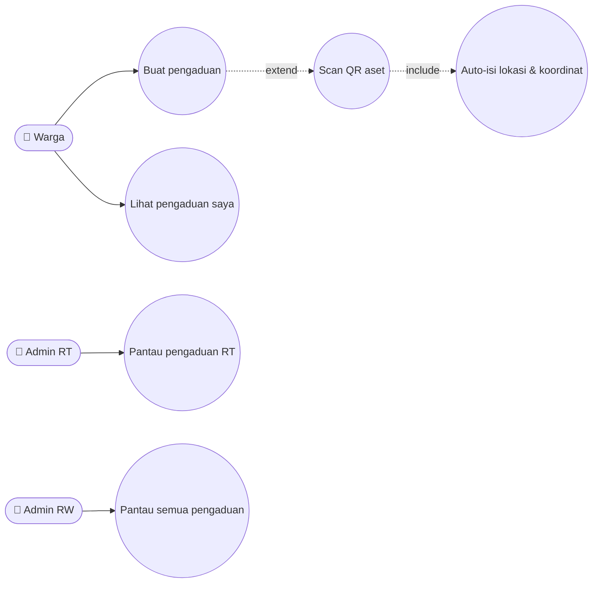
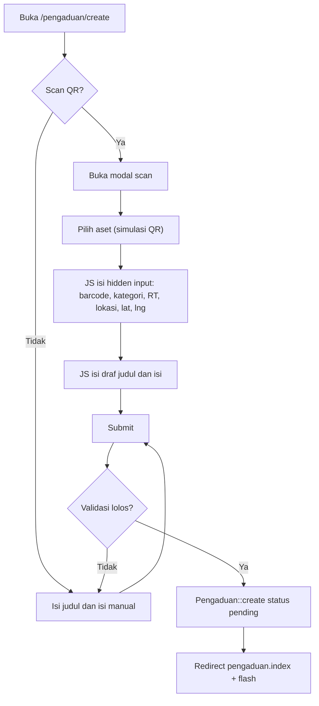
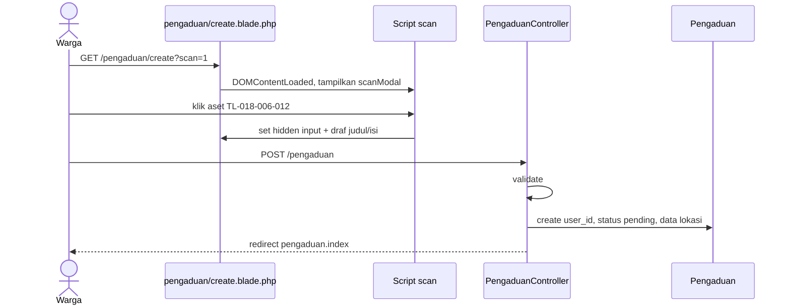
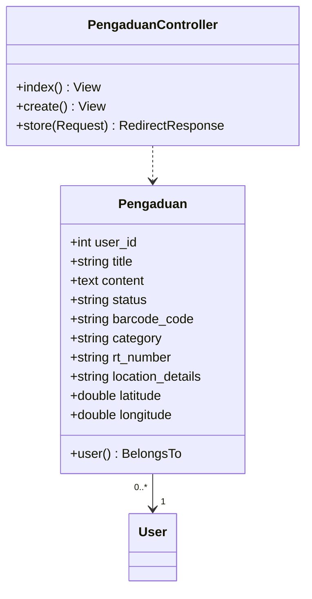
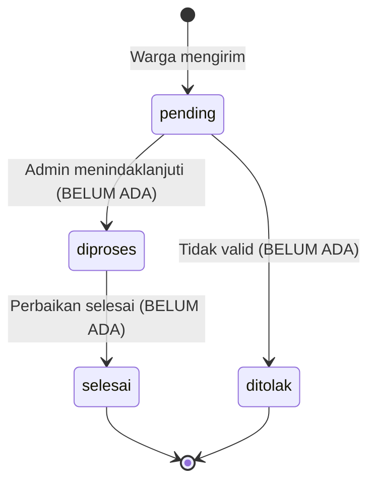

# 📢 PENGADUAN_WARGA

> Pelaporan kerusakan fasilitas lingkungan, dipercepat dengan pemindaian **QR Code aset** (tiang listrik, hydrant, CCTV, bak sampah, portal) yang mengisi lokasi & koordinat otomatis.

## 1. Ringkasan
Warga membuat pengaduan (judul + isi). Opsional, warga "memindai" QR aset lingkungan; sistem otomatis mengisi kode aset, kategori, RT, detail lokasi, latitude/longitude, serta draf judul & isi laporan. Pengaduan tersimpan dengan status `pending`.

> [!NOTE]
> Pemindaian QR saat ini adalah **simulasi** (modal berisi daftar aset contoh dengan atribut `data-*`), belum memakai kamera.

## 2. Aktor & Hak Akses
| Aktor | Kirim | Lihat |
|---|---|---|
| Warga / Bendahara | ✅ | Pengaduan miliknya |
| Admin RT | ✅ | Pengaduan dari pelapor yang ber-RT sama (`whereHas user.rt_number`) |
| Admin RW | ✅ | Semua pengaduan |

## 3. File Terkait
| Jenis | Path |
|---|---|
| Controller | `app/Http/Controllers/PengaduanController.php` |
| Model | `app/Models/Pengaduan.php` |
| View | `resources/views/pengaduan/index.blade.php`, `create.blade.php` (modal `#scanModal`, `?scan=1` auto-open) |
| Migrasi | `2026_07_09_000002_create_pengaduans_table.php` |

## 4. Route (`only: index, create, store`)
| Method | URI | Name |
|---|---|---|
| GET | `/pengaduan` | `pengaduan.index` (10/hal) |
| GET | `/pengaduan/create` (opsional `?scan=1`) | `pengaduan.create` |
| POST | `/pengaduan` | `pengaduan.store` |

## 5. Aturan Bisnis
1. `user_id` = user login; `status` awal = `pending`.
2. Data aset contoh (QR simulasi):

   | Kode | Kategori | RT |
   |---|---|---|
   | `TL-018-006-012` | Tiang Listrik (Kelistrikan) | 006 |
   | `HYD-018-007-003` | Hydrant Damkar (Utilitas Air) | 007 |
   | `CCTV-018-008-005` | Tiang WiFi/CCTV (Keamanan) | 008 |
   | `BSK-018-009-001` | Bak Sampah (Sanitasi) | 009 |
   | `PRT-018-010-002` | Portal Gate (Akses RW) | 010 |

   Format kode: `{JENIS}-{RW}-{RT}-{NOMOR}`.
3. Field hasil scan dikirim lewat hidden input: `barcode_code`, `category`, `rt_number`, `location_details`, `latitude`, `longitude`.

## 6. Use Case Diagram

## 7. Flowchart

## 8. Sequence Diagram

## 9. Class Diagram

## 10. State Diagram (Target)

> Saat ini **hanya status `pending`** yang diimplementasikan.

## 11. Validasi
| Field | Rule |
|---|---|
| title | required, max 255 |
| content | required, max 2000 |
| barcode_code | nullable, max 100 |
| category | nullable, max 100 |
| rt_number | nullable, max 10 |
| location_details | nullable, max 255 |
| latitude, longitude | nullable, numeric |

## 12. Known Issues & Pengembangan Lanjutan
| # | Isu | Rekomendasi |
|---|---|---|
| 🟠 1 | Tidak ada update status / tanggapan admin | Route `PATCH /pengaduan/{id}/status` + kolom `tanggapan` |
| 🟡 2 | Filter Admin RT memakai RT pelapor, bukan `pengaduan.rt_number` lokasi aset | Gunakan `rt_number` lokasi bila terisi |
| 🟡 3 | QR hanya simulasi | `html5-qrcode` + master tabel `aset_lingkungan` |
| 🟡 4 | Tidak ada lampiran foto | Upload foto kerusakan |
| 🟢 5 | Koordinat tidak divisualisasikan | Peta Leaflet/OpenStreetMap |
