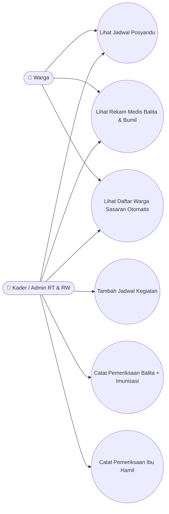
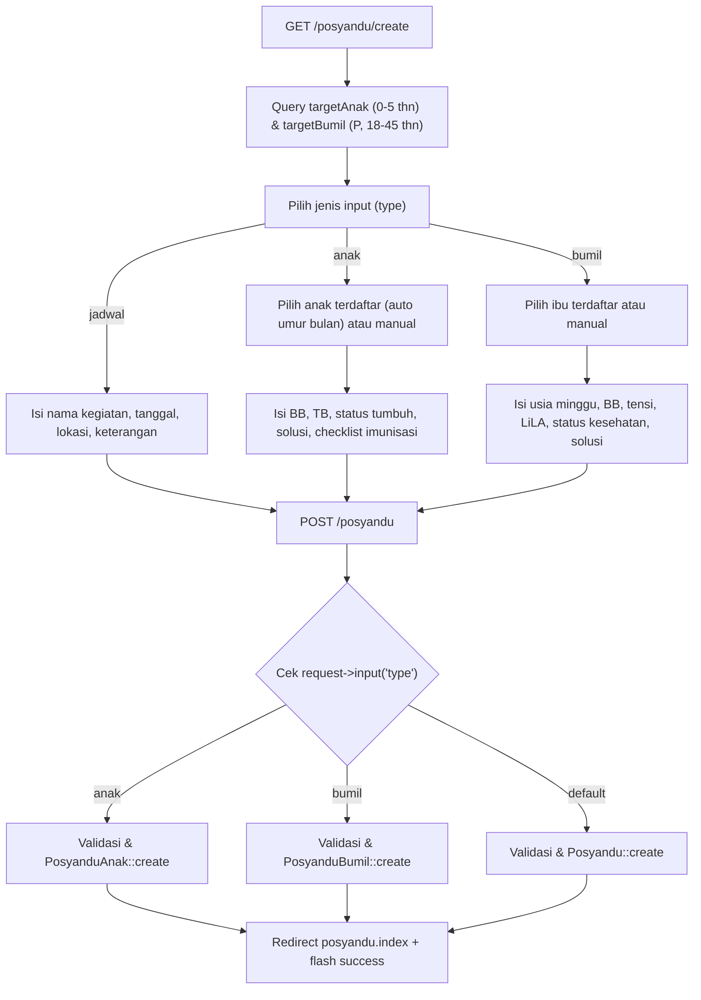
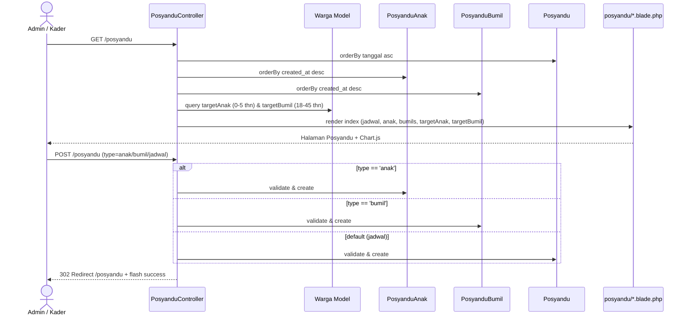
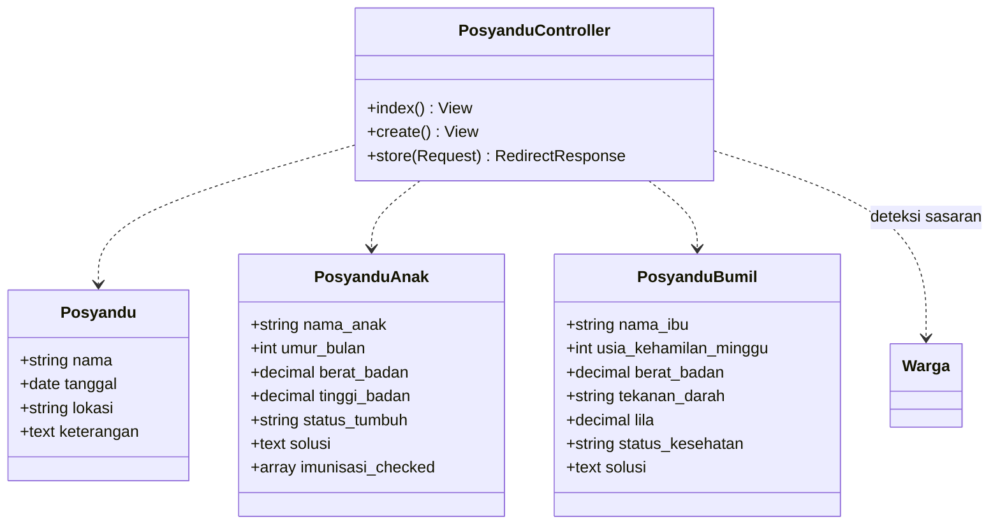

# 👶 POSYANDU

> Informasi jadwal kegiatan Posyandu, rekam medis tumbuh kembang balita (0–5 tahun), rekam medis kesehatan ibu hamil (18–45 tahun), serta deteksi otomatis warga sasaran Posyandu.

## 1. Ringkasan
Modul Posyandu menyatukan tiga entitas kesehatan warga dalam satu portal (`/posyandu`):
1. **Jadwal Kegiatan Posyandu** (`posyandus`) — nama kegiatan, tanggal, lokasi, keterangan.
2. **Rekam Medis Balita** (`posyandu_anaks`) — nama anak, umur (bulan), berat/tinggi badan, status tumbuh (Normal / Kurang Gizi / Stunting / Overweight), daftar imunisasi (`JSON`), dan catatan/solusi.
3. **Rekam Medis Ibu Hamil** (`posyandu_bumils`) — nama ibu, usia kehamilan (minggu), berat badan, tekanan darah, lingkar lengan atas (LiLA), status kesehatan (Sehat / KEK / Hipertensi Gestasional / Anemia Ringan), dan solusi.

Sistem juga **menarik otomatis daftar sasaran (target)** dari tabel `wargas` berdasarkan tanggal lahir & status keluarga:
- **Target Balita**: anggota keluarga (`is_kk = false`) berusia **0–5 tahun**.
- **Target Ibu Hamil**: anggota keluarga perempuan (`is_kk = false`, `gender = 'P'`) berusia **18–45 tahun**.

## 2. Aktor & Hak Akses
| Aktor | Lihat Jadwal, Rekam Medis & Sasaran | Tambah Jadwal / Rekam Medis |
|---|---|---|
| Warga | ✅ | ✅ *(saat ini terbuka di backend — lihat Known Issues)* |
| Admin RT | ✅ | ✅ |
| Admin RW / Bendahara | ✅ | ✅ |

## 3. File Terkait
| Jenis | Path |
|---|---|
| Controller | [`app/Http/Controllers/PosyanduController.php`](file:///c:/laragon/www/iuran-anggi/app/Http/Controllers/PosyanduController.php) |
| Model | [`Posyandu`](file:///c:/laragon/www/iuran-anggi/app/Models/Posyandu.php), [`PosyanduAnak`](file:///c:/laragon/www/iuran-anggi/app/Models/PosyanduAnak.php), [`PosyanduBumil`](file:///c:/laragon/www/iuran-anggi/app/Models/PosyanduBumil.php), [`Warga`](file:///c:/laragon/www/iuran-anggi/app/Models/warga.php) |
| View | [`resources/views/posyandu/index.blade.php`](file:///c:/laragon/www/iuran-anggi/resources/views/posyandu/index.blade.php), [`create.blade.php`](file:///c:/laragon/www/iuran-anggi/resources/views/posyandu/create.blade.php) |
| Migrasi | `2026_07_09_000003_create_posyandus_table.php`, `2026_07_16_000003_create_posyandu_anaks_table.php`, `2026_07_16_000004_create_posyandu_bumils_table.php` |
| Legacy | `PosyanduDashboardController` (tidak terdaftar di `routes/web.php`) |

## 4. Route (`only: index, create, store`)
| Method | URI | Name | Aksi |
|---|---|---|---|
| GET | `/posyandu` | `posyandu.index` | Tampilkan jadwal, rekam medis anak & bumil, grafik, dan daftar warga sasaran |
| GET | `/posyandu/create` | `posyandu.create` | Form dinamis (pilih jenis: `jadwal`, `anak`, atau `bumil`) |
| POST | `/posyandu` | `posyandu.store` | Simpan sesuai field `type` |

## 5. Aturan Bisnis
1. **Perhitungan Sasaran Otomatis (`Carbon`)**:
   - `batasBalita = now()->subYears(5)->format('Y-m-d')` → `tanggal_lahir >= batasBalita` dan `is_kk = false`.
   - `minimalUmur = now()->subYears(18)->format('Y-m-d')`, `maksimalUmur = now()->subYears(45)->format('Y-m-d')` → `gender = 'P'`, `is_kk = false`, `whereBetween('tanggal_lahir', [maksimalUmur, minimalUmur])`.
2. **Form Create Dinamis**:
   - Dropdown `type` menentukan section form yang aktif (`jadwal` / `anak` / `bumil`).
   - Saat memilih anak terdaftar dari dropdown `targetAnak`, JavaScript otomatis mengisi `nama_anak` dan menghitung `umur_bulan` dari `data-tgllahir`. Tersedia juga opsi `-- Input Nama Secara Manual --`.
3. **Penyimpanan Multi-Tipe (`PosyanduController@store`)**:
   - `type === 'anak'` → simpan ke `PosyanduAnak` (`imunisasi_checked` di-cast sebagai `array` / JSON).
   - `type === 'bumil'` → simpan ke `PosyanduBumil`.
   - selain itu (default `jadwal`) → simpan ke `Posyandu`.

## 6. Use Case Diagram

## 7. Flowchart — Pencatatan Data Posyandu

## 8. Sequence Diagram

## 9. Class Diagram

## 10. Validasi
| Tipe | Field | Rule |
|---|---|---|
| `anak` | `nama_anak` | `required\|string\|max:255` |
| `anak` | `umur_bulan` | `required\|integer\|min:0` |
| `anak` | `berat_badan`, `tinggi_badan` | `required\|numeric\|min:0` |
| `anak` | `status_tumbuh` | `required\|string\|max:100` |
| `anak` | `solusi` | `nullable\|string\|max:2000` |
| `anak` | `imunisasi_checked` | `nullable\|array` |
| `bumil` | `nama_ibu` | `required\|string\|max:255` |
| `bumil` | `usia_kehamilan_minggu` | `required\|integer\|min:0` |
| `bumil` | `berat_badan`, `lila` | `required\|numeric\|min:0` |
| `bumil` | `tekanan_darah` | `required\|string\|max:50` |
| `bumil` | `status_kesehatan` | `required\|string\|max:100` |
| `bumil` | `solusi` | `nullable\|string\|max:2000` |
| `jadwal` | `nama` | `required\|string\|max:255` |
| `jadwal` | `tanggal` | `required\|date` |
| `jadwal` | `lokasi` | `nullable\|string\|max:255` |
| `jadwal` | `keterangan` | `nullable\|string\|max:2000` |

## 11. Known Issues & Pengembangan Lanjutan
| # | Isu | Rekomendasi |
|---|---|---|
| 🟠 1 | `create` & `store` belum dibatasi ke pengurus/kader (warga biasa dapat menambah jadwal/rekam medis) | Batasi `create`/`store` hanya untuk `isAdmin()` atau role khusus `kader` |
| 🟡 2 | `PosyanduAnak` & `PosyanduBumil` menyimpan `nama_anak`/`nama_ibu` sebagai string, bukan `warga_id` FK | Tambahkan `warga_id` nullable agar riwayat pertumbuhan per anak dapat ditelusuri akurat |
| 🟡 3 | Data rekam medis belum difilter per RT atau per keluarga warga yang login | Tambahkan filter RT untuk Admin RT & filter keluarga untuk Warga |
| 🟢 4 | Belum ada fitur edit/hapus jadwal maupun rekam medis | Lengkapi resource route (`edit`, `update`, `destroy`) |
