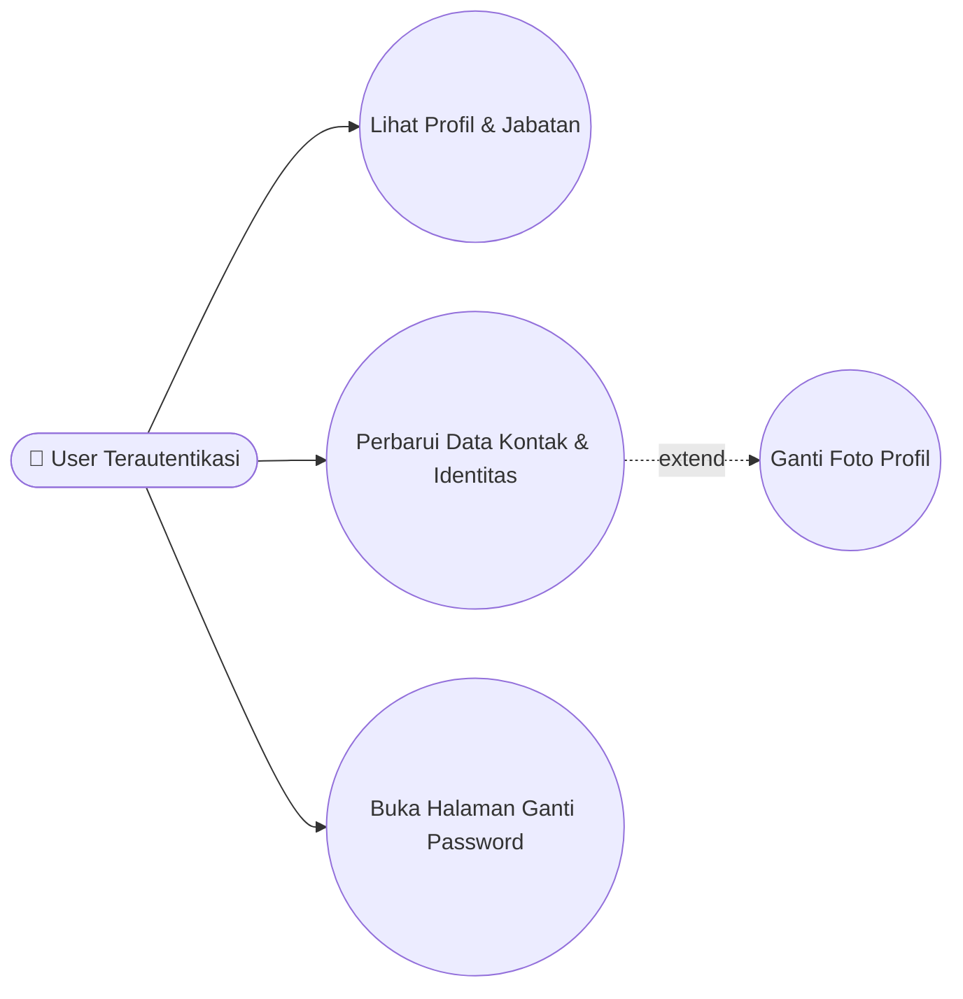
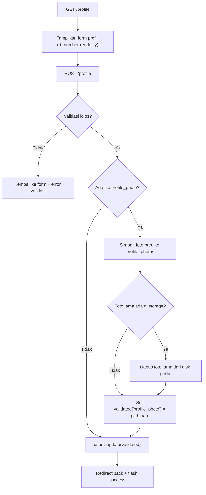
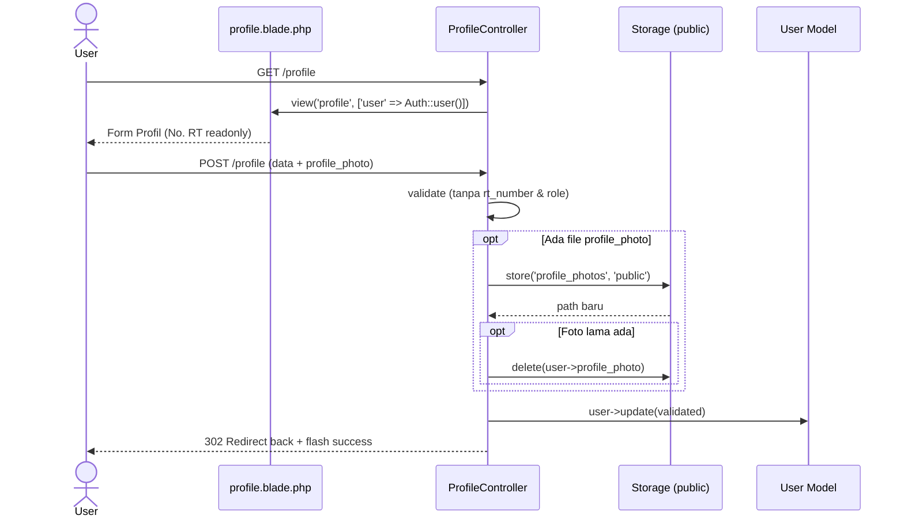
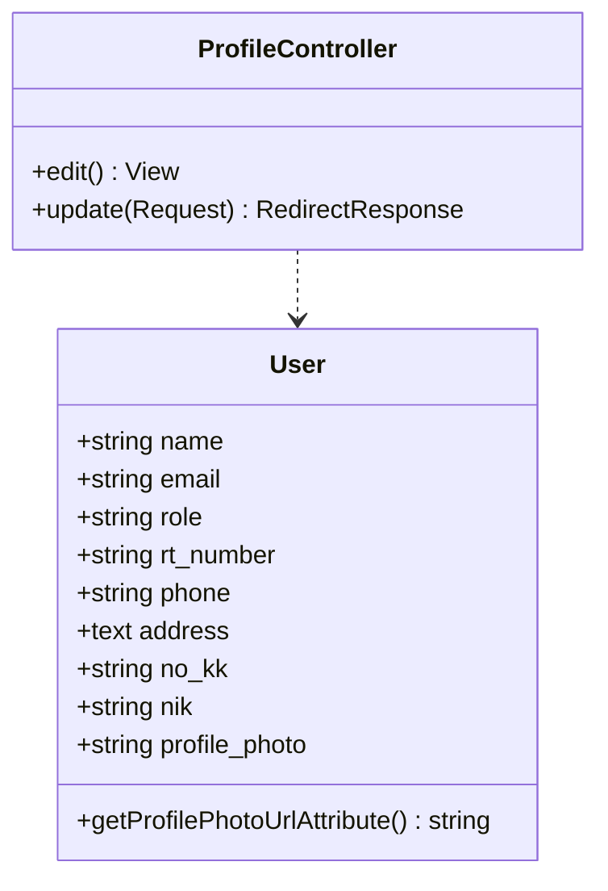

# 👤 PROFIL_PENGGUNA

> Pengelolaan identitas akun pengguna, foto profil, dan perlindungan atribut jabatan (`rt_number`).

## 1. Ringkasan
Setiap pengguna yang sudah login (Warga, Admin RT, Admin RW, Bendahara) dapat memperbarui data profilnya melalui `/profile`: nama, email, nomor HP, alamat, No. KK, NIK, serta mengunggah foto profil baru.

> [!CAUTION]
> **Invarian Keamanan Jabatan (INV-1)**: Kolom `rt_number` di halaman profil **dikunci (`readonly`)** di tampilan dan **dihapus dari validasi/update** di `ProfileController@update`. Hal ini mencegah Admin RW (`rt_number = '000'`) atau Admin RT secara tidak sengaja mengubah nomor RT-nya menjadi alamat rumahnya sehingga kehilangan hak akses jabatannya.

## 2. Aktor & Hak Akses
| Aktor | Lihat & Edit Profil Sendiri | Ubah `rt_number` / `role` |
|---|---|---|
| Warga | ✅ | ❌ (dikunci) |
| Admin RT | ✅ | ❌ (dikunci) |
| Admin RW | ✅ | ❌ (dikunci — tetap `000`) |
| Bendahara | ✅ | ❌ (dikunci) |

## 3. File Terkait
| Jenis | Path |
|---|---|
| Controller | [`app/Http/Controllers/ProfileController.php`](file:///c:/laragon/www/iuran-anggi/app/Http/Controllers/ProfileController.php) |
| Model | [`app/Models/User.php`](file:///c:/laragon/www/iuran-anggi/app/Models/User.php) |
| View | [`resources/views/profile.blade.php`](file:///c:/laragon/www/iuran-anggi/resources/views/profile.blade.php) |
| Storage | `storage/app/public/profile_photos/` |

## 4. Route
| Method | URI | Name | Aksi |
|---|---|---|---|
| GET | `/profile` | `profile.edit` | Tampilkan halaman profil pengguna aktif |
| POST | `/profile` | `profile.update` | Simpan perubahan profil & foto |

## 5. Aturan Bisnis
1. Email harus unik di tabel `users`, kecuali milik user yang sedang login (`Rule::unique('users')->ignore($user->id)`).
2. Jika mengunggah `profile_photo` baru:
   - Simpan ke `storage/app/public/profile_photos`.
   - Hapus file foto lama dari disk `public` jika ada.
3. Jika pengguna belum memiliki foto profil, accessor `User::getProfilePhotoUrlAttribute()` otomatis menghasilkan avatar inisial nama dari `https://ui-avatars.com`.
4. `rt_number` dan `role` **tidak pernah** ikut di-update melalui endpoint ini.

## 6. Use Case Diagram

## 7. Flowchart — Update Profil

## 8. Sequence Diagram

## 9. Class Diagram

## 10. Validasi
| Field | Rule |
|---|---|
| `name` | `required\|string\|max:255` |
| `email` | `required\|email\|max:255\|unique:users,email,{id}` |
| `phone` | `required\|string\|max:15` |
| `address` | `required\|string` |
| `no_kk` | `nullable\|string\|max:25` |
| `nik` | `nullable\|string\|max:25` |
| `profile_photo` | `nullable\|image\|mimes:jpg,jpeg,png\|max:2048` |

## 11. Known Issues & Pengembangan Lanjutan
| # | Isu | Rekomendasi |
|---|---|---|
| 🟡 1 | Perubahan data di `users` (nama, HP, alamat, foto, NIK, No. KK) belum otomatis disinkronkan ke record terkait di tabel `wargas` | Sinkronkan `user->warga->update(...)` saat profil diperbarui |
| 🟢 2 | Pesan flash sukses masih berbunyi `"Profil admin RT berhasil diperbarui."` untuk semua role | Ubah menjadi `"Profil berhasil diperbarui."` |
