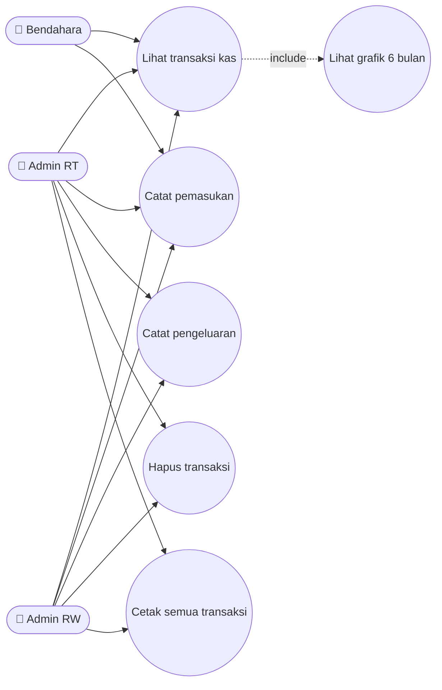
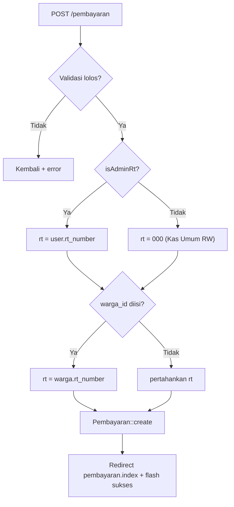
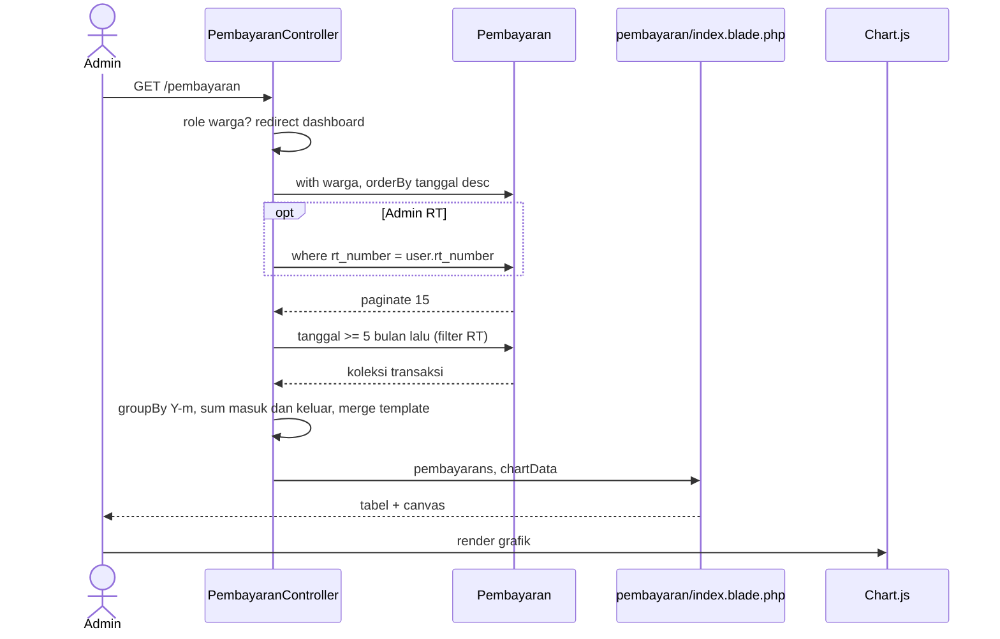
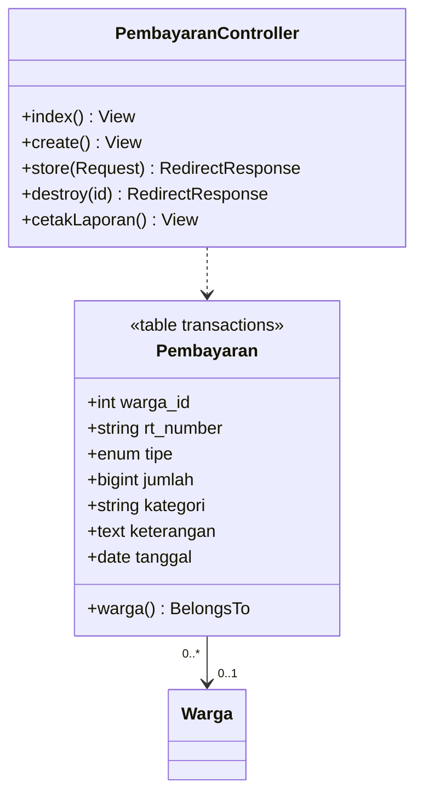

# 💰 TRANSAKSI_KAS

> Pencatatan pemasukan & pengeluaran kas dengan isolasi per RT dan agregasi gabungan untuk RW.

## 1. Ringkasan
Setiap uang masuk (iuran, donasi) dan keluar (kebersihan, listrik, perbaikan) dicatat di tabel **`transactions`** (model `Pembayaran`). Setiap baris wajib memiliki `rt_number` sehingga **tiap RT memiliki kas sendiri**, sedangkan **Admin RW melihat kas gabungan** seluruh RT. Halaman index menampilkan tabel transaksi (15/hal) + grafik 6 bulan.

## 2. Aktor & Hak Akses
| Aktor | Lihat | Tambah | Hapus | Cetak |
|---|---|---|---|---|
| Warga | ❌ redirect + error "hanya untuk pengurus" | ❌ | ❌ | ❌ |
| Admin RT | ✅ kas RT-nya | ✅ (warga RT-nya) | ✅ hanya transaksi RT-nya | ✅ RT-nya |
| Admin RW | ✅ gabungan | ✅ semua warga | ✅ semua | ✅ gabungan |
| Bendahara | ✅ gabungan | ✅ | ✅ | ✅ |

## 3. File Terkait
| Jenis | Path |
|---|---|
| Controller | `app/Http/Controllers/PembayaranController.php` (`index`, `create`, `store`, `destroy`, `cetakLaporan`) |
| Model | `app/Models/Pembayaran.php` → `$table = 'transactions'` |
| View | `resources/views/pembayaran/index.blade.php`, `create.blade.php`, `cetak.blade.php` |
| Migrasi | `2026_05_07_202901_create_transactions_table.php`, `2026_07_24_041417_add_rt_number_to_transactions_table.php` |

## 4. Route
| Method | URI | Name | Aksi |
|---|---|---|---|
| GET | `/pembayaran` | `pembayaran.index` | Tabel + grafik |
| GET | `/pembayaran/create` | `pembayaran.create` | Form |
| POST | `/pembayaran` | `pembayaran.store` | Simpan |
| DELETE | `/pembayaran/{id}` | `pembayaran.destroy` | Hapus |
| GET | `/laporan/cetak` | `laporan.cetak` | Cetak seluruh transaksi (filter role) |

## 5. Aturan Bisnis
1. **Penentuan `rt_number` saat simpan:**
   ```
   rt_number = isAdminRt ? user.rt_number : '000'
   jika warga_id diisi → rt_number = warga.rt_number
   ```
   `'000'` = **Kas Umum RW** (transaksi Admin RW tanpa warga).
2. `warga_id` opsional → kosong = "Kas Umum / Non-Warga".
3. Kategori dari dropdown:
   - Pemasukan: `Iuran Bulanan`, `Iuran Sukarela`, `Donasi Warga`
   - Pengeluaran: `Kebersihan`, `Keamanan`, `Listrik & Air`, `Perbaikan/Maintenance`, `Lain-lain`
4. Kategori yang mengandung kata **`Iuran`** dihitung sebagai pembayaran iuran di [LAPORAN_IURAN.md](./LAPORAN_IURAN.md) & dashboard.
5. Admin RT tidak boleh menghapus transaksi RT lain.
6. Grafik: template 6 bulan terakhir (nilai 0) di-merge dengan data yang di-`groupBy` per `Y-m` **di PHP** (portable).

## 6. Use Case Diagram


## 7. Flowchart — Simpan Transaksi


## 8. Sequence Diagram — Index + Grafik


## 9. Class Diagram


## 10. Validasi
| Field | Rule |
|---|---|
| warga_id | nullable, exists:wargas,id |
| tipe | required, in masuk,keluar |
| jumlah | required, numeric |
| kategori | required, string |
| tanggal | required, date |
| keterangan | nullable |

## 11. Known Issues & Pengembangan Lanjutan
| # | Isu | Rekomendasi |
|---|---|---|
| 🟠 1 | `store` tidak menolak role warga secara eksplisit (hanya `create` yang redirect) | Tambah guard `isWarga()` di `store` |
| 🟠 2 | Admin RT bisa mengirim `warga_id` milik RT lain via request manipulasi → transaksi masuk ke RT lain | Validasi warga harus di RT admin |
| 🟡 3 | `jumlah` tidak dibatasi minimal > 0 | `numeric|min:1` |
| 🟡 4 | Tidak ada fitur edit transaksi (hanya hapus) | Tambah edit + audit log |
| 🟡 5 | Tidak ada bukti transfer/nota | Kolom `bukti` (upload) |
| 🟢 6 | Belum ada soft delete untuk jejak audit | `SoftDeletes` |
