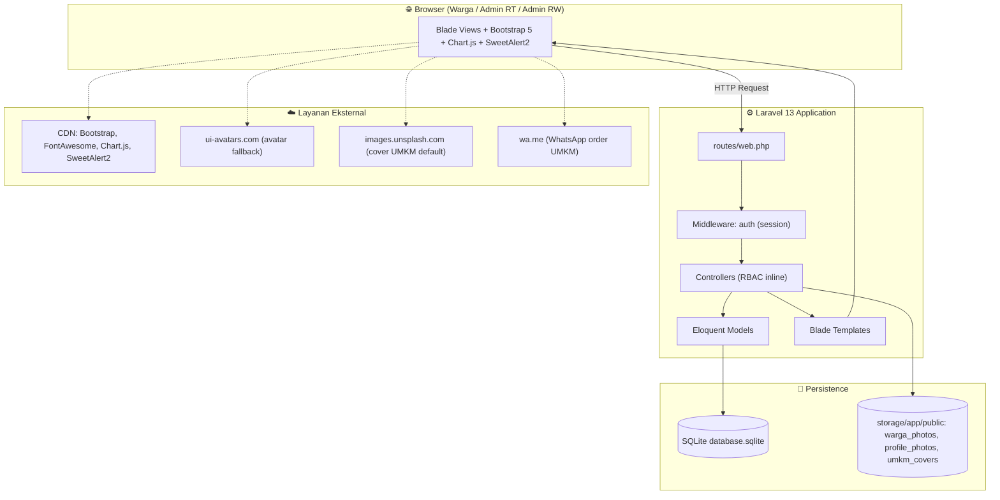
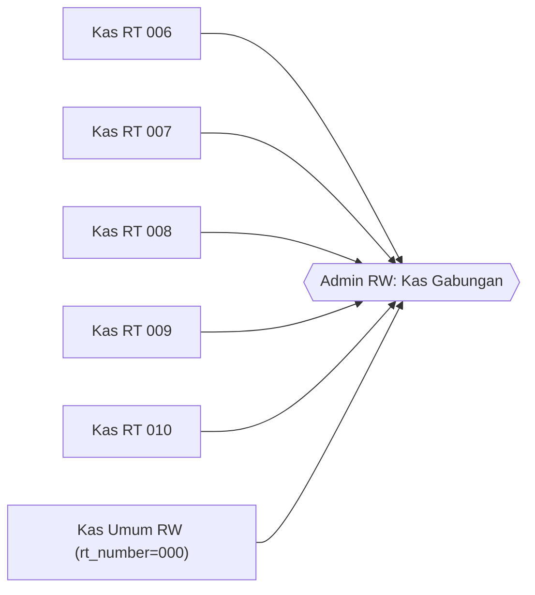
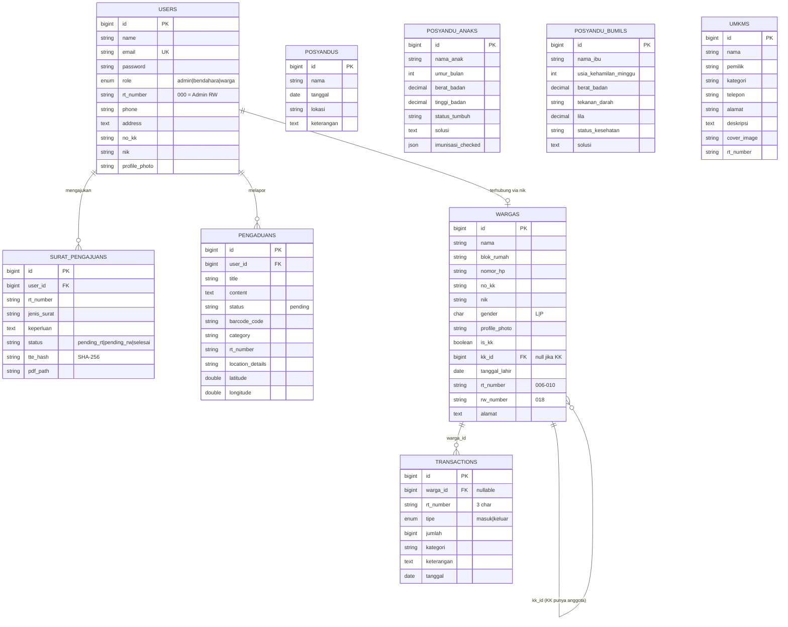
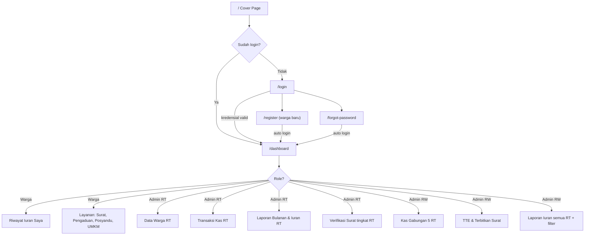
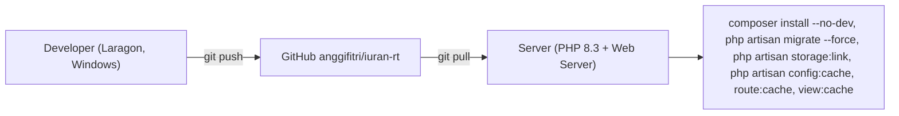

# 🏘️ NexaNest — System Blueprint

> **Platform Digital RW 018** untuk pengelolaan Kas/Iuran, Data Warga, Penerbitan Surat ber-TTE, Pengaduan, Posyandu, dan Direktori UMKM.
>
> Dokumen ini adalah **sumber kebenaran tertinggi (single source of truth)** arsitektur NexaNest. Setiap AI/Agent/Developer **WAJIB** membaca [role.md](./role.md) terlebih dahulu, lalu dokumen ini, sebelum menyentuh kode.

| Atribut | Nilai |
|---|---|
| Nama Sistem | NexaNest |
| Repository | `anggifitri/iuran-rt` |
| Root Lokal | `c:\laragon\www\iuran-anggi` |
| Cakupan Wilayah | 1 RW (RW 018) dengan 5 RT: **006, 007, 008, 009, 010** |
| Versi Dokumen | 1.0.0 |
| Terakhir Diperbarui | 2026-10-28 |

---

## 1. Daftar Isi Dokumentasi

| Dokumen | Isi |
|---|---|
| [role.md](./role.md) | **Aturan wajib** untuk AI/Agent/Developer yang mengembangkan sistem |
| [blueprint.md](./blueprint.md) | Dokumen ini — arsitektur & gambaran besar |
| [AUTENTIKASI.md](./AUTENTIKASI.md) | Login, Registrasi Warga, Reset Password, Logout |
| [DASHBOARD.md](./DASHBOARD.md) | Dashboard multi-role, statistik, grafik arus kas, kartu info |
| [MANAJEMEN_WARGA.md](./MANAJEMEN_WARGA.md) | CRUD data warga, struktur Kepala Keluarga & anggota |
| [TRANSAKSI_KAS.md](./TRANSAKSI_KAS.md) | Pencatatan pemasukan/pengeluaran kas per-RT |
| [LAPORAN_KEUANGAN.md](./LAPORAN_KEUANGAN.md) | Laporan bulanan (saldo awal–akhir) & cetak |
| [LAPORAN_IURAN.md](./LAPORAN_IURAN.md) | Status iuran per KK, ketaatan bayar, riwayat warga |
| [PENERBITAN_SURAT.md](./PENERBITAN_SURAT.md) | Alur pengajuan surat 2 tingkat (RT → RW) + TTE SHA-256 |
| [PENGADUAN_WARGA.md](./PENGADUAN_WARGA.md) | Pengaduan via QR Code aset lingkungan + geolokasi |
| [POSYANDU.md](./POSYANDU.md) | Jadwal posyandu, rekam medis balita & ibu hamil |
| [DIREKTORI_UMKM.md](./DIREKTORI_UMKM.md) | Katalog UMKM warga + integrasi WhatsApp order |
| [PROFIL_PENGGUNA.md](./PROFIL_PENGGUNA.md) | Kelola profil akun & foto |

---

## 2. Visi & Tujuan

1. **Transparansi keuangan** — setiap RT punya kas sendiri; RW melihat agregat seluruh RT.
2. **Layanan mandiri warga** — ajukan surat, lapor kerusakan, cek riwayat iuran tanpa datang ke rumah RT.
3. **Digitalisasi administrasi** — surat diterbitkan dengan Tanda Tangan Elektronik (hash SHA-256).
4. **Kesehatan & ekonomi** — data posyandu terpusat & etalase UMKM warga.

---

## 3. Technology Stack

| Layer | Teknologi | Catatan |
|---|---|---|
| Bahasa | PHP `^8.3` | |
| Framework | **Laravel `^13.0`** | Struktur Laravel 11+ (`bootstrap/app.php`, tanpa `Kernel.php`) |
| Database | **SQLite** (`DB_CONNECTION=sqlite`) | ⚠️ Query raw harus kompatibel SQLite (lihat role.md) |
| Session / Cache / Queue | `database` driver | Tabel `sessions`, `cache`, `jobs` |
| Template | Blade | Layout utama: `resources/views/layouts/app.blade.php` |
| CSS Framework | **Bootstrap 5.3 (CDN)** | Tailwind ada di `package.json` tapi **tidak dipakai** di view |
| Ikon | Font Awesome 6.4 (CDN) | |
| Font | Inter, Montserrat (Google Fonts) | |
| Grafik | Chart.js (CDN) | Dashboard, Transaksi Kas, Posyandu |
| Notifikasi UI | SweetAlert2 (CDN) | Flash `session('success')` |
| Tema | Dark / Light toggle | Disimpan di `localStorage('theme')` |
| Build tool | Vite 8 | Opsional; view saat ini memuat aset via CDN |
| Testing | PHPUnit 12 | `tests/Feature`, `tests/Unit` |
| Dev Server | Laragon (Windows) | |

---

## 4. Arsitektur Tingkat Tinggi



**Pola:** Monolith MVC klasik (server-side rendering). Belum ada API JSON kecuali `GET /umkm/categories`.

---

## 5. Model Role & Access Control (RBAC)

### 5.1 Penentuan Role

Role ditentukan oleh kombinasi kolom `users.role` dan `users.rt_number`:

| Role Efektif | Kondisi di DB | Helper di `User` model |
|---|---|---|
| **Admin RW** | `role = 'admin'` **AND** `rt_number = '000'` (atau `role = 'admin_rw'`) | `isAdminRw()` |
| **Admin RT** | `role = 'admin'` **AND** `rt_number != '000'` (atau `role = 'admin_rt'`) | `isAdminRt()` |
| **Bendahara** | `role = 'bendahara'` | `isBendahara()` |
| **Warga** | `role = 'warga'` | `isWarga()` |
| (umum) Admin | `role in ('admin','admin_rt','admin_rw')` | `isAdmin()` |

> [!CAUTION]
> `rt_number = '000'` adalah **penanda jabatan Admin RW**. Mengubah `rt_number` akun admin akan mengubah hak aksesnya. Karena itu input `rt_number` di halaman Profil **dikunci (readonly)** dan tidak divalidasi/diupdate oleh `ProfileController`.

### 5.2 Matriks Hak Akses

| Fitur / Aksi | Warga | Admin RT | Admin RW | Bendahara |
|---|:-:|:-:|:-:|:-:|
| Dashboard | ✅ data pribadi | ✅ data RT-nya | ✅ agregat semua RT | ✅ agregat |
| Data Warga (CRUD) | ❌ | ✅ hanya RT-nya | ✅ semua RT | ✅ semua RT |
| Transaksi Kas (lihat/tambah/hapus) | ❌ | ✅ kas RT-nya | ✅ semua kas (gabungan) | ✅ semua |
| Laporan Bulanan + Cetak | ❌ | ✅ RT-nya | ✅ gabungan | ✅ gabungan |
| Laporan Iuran | ✅ **hanya miliknya** ("Riwayat Iuran Saya") | ✅ KK di RT-nya | ✅ semua + filter RT | ✅ semua |
| Cetak Laporan Iuran | ❌ | ✅ | ✅ | ✅ |
| Ajukan Surat | ✅ (status `pending_rt`) | ✅ buat untuk warga → `pending_rw` | ✅ buat langsung `selesai` + TTE | ✅ seperti warga |
| Setujui Surat tingkat RT | ❌ | ✅ | ❌ | ❌ |
| TTE & Terbitkan Surat (RW) | ❌ | ❌ | ✅ | ❌ |
| Unduh/Lihat PDF Surat | ✅ (jika `selesai`) | ✅ | ✅ | ✅ |
| Pengaduan (kirim) | ✅ | ✅ | ✅ | ✅ |
| Pengaduan (lihat) | Miliknya | Pelapor di RT-nya | Semua | Miliknya |
| Posyandu (lihat/tambah) | ✅ / ✅* | ✅ / ✅ | ✅ / ✅ | ✅ / ✅ |
| UMKM (lihat/tambah) | ✅ / ✅ | ✅ / ✅ | ✅ / ✅ | ✅ / ✅ |
| Profil | ✅ | ✅ | ✅ | ✅ |

\* Saat ini belum dibatasi di backend — lihat bagian *Technical Debt*.

### 5.3 Prinsip Isolasi Kas



- Setiap baris `transactions` memiliki `rt_number`.
- Admin RT **selalu** difilter `where('rt_number', $user->rt_number)`.
- Admin RW/Bendahara **tanpa filter** → melihat total gabungan.
- Warga **tidak** pernah melihat tabel kas; hanya pembayaran miliknya (`warga_id`).

---

## 6. Entity Relationship Diagram (ERD)



### 6.1 Tabel Legacy (tidak dipakai alur aktif)

| Tabel | Model | Status |
|---|---|---|
| `iurans` | `Iuran` | Legacy — dipakai `IuranController` yang **tidak terdaftar** di routes |
| `pembayarans` | — | Legacy — digantikan `transactions` (model `Pembayaran` menunjuk ke `transactions`) |
| `kas_r_t_s` | — | Legacy — saldo dihitung on-the-fly dari `transactions` |
| `surats` | `Surat` | Legacy — digantikan `surat_pengajuans` |
| `pengumumans` | `Pengumuman` | Ada, tapi dashboard kini memakai kartu info dinamis |

> [!WARNING]
> Model `Pembayaran` memakai `protected $table = 'transactions'`. **Jangan** tertukar dengan tabel legacy `pembayarans`.

---

## 7. Struktur Direktori Kunci

```text
iuran-anggi/
├── app/
│   ├── Http/
│   │   ├── Controllers/
│   │   │   ├── AuthController.php            # Login, register, reset, logout
│   │   │   ├── DashboardController.php       # Dashboard multi-role
│   │   │   ├── WargaController.php           # CRUD warga
│   │   │   ├── PembayaranController.php      # Kas + Laporan Bulanan + Laporan Iuran
│   │   │   ├── SuratPengajuanController.php  # Surat + TTE
│   │   │   ├── PengaduanController.php
│   │   │   ├── PosyanduController.php
│   │   │   ├── UmkmController.php
│   │   │   ├── ProfileController.php
│   │   │   └── (legacy) IuranController, KasController, SuratController, PosyanduDashboardController
│   │   └── Middleware/RoleMiddleware.php     # Ada, BELUM didaftarkan
│   └── Models/  User, Warga(warga.php), Pembayaran, SuratPengajuan, Pengaduan,
│                Posyandu, PosyanduAnak, PosyanduBumil, Umkm, (legacy) Iuran, Surat, Pengumuman
├── database/
│   ├── migrations/      # 2026_04_05 … 2026_07_24
│   └── seeders/         # DatabaseSeeder, WargaAestheticSeeder, UmkmSeeder, SuratPengajuanSeeder, …
├── resources/views/
│   ├── layouts/app.blade.php   # Navbar, tema, flash, SweetAlert
│   ├── dashboard.blade.php     # Sidebar navigasi role-aware
│   ├── auth/ warga/ pembayaran/ laporan/ surat/ pengaduan/ posyandu/ umkm/
│   └── cover.blade.php         # Landing page sebelum login
├── routes/web.php
└── docs/                       # ← Dokumentasi ini
```

> [!NOTE]
> File model warga bernama `app/Models/warga.php` (huruf kecil) tetapi class-nya `Warga`. Di Windows ini aman; di Linux (case-sensitive) autoload PSR-4 bisa gagal. Lihat role.md.

---

## 8. Peta Route

| Method | URI | Name | Controller@method | Akses |
|---|---|---|---|---|
| GET | `/` | — | closure → `cover` | Publik |
| GET/POST | `/login` | `login` | `AuthController@showLogin/login` | Guest |
| GET/POST | `/register` | `register` | `AuthController@showRegister/register` | Guest |
| GET/POST | `/forgot-password` | `password.request` / `password.email` | `AuthController` | Guest |
| POST | `/logout` | `logout` | `AuthController@logout` | Auth |
| GET | `/dashboard` | `dashboard` | `DashboardController@index` | Auth |
| RESOURCE | `/warga` | `warga.*` | `WargaController` | Admin |
| RESOURCE | `/pembayaran` | `pembayaran.*` | `PembayaranController` | Admin |
| GET | `/laporan` | `laporan.index` | `PembayaranController@indexLaporan` | Admin |
| GET | `/laporan/cetak` | `laporan.cetak` | `PembayaranController@cetakLaporan` | Admin |
| GET | `/laporan/cetak-bulanan` | `laporan.cetak_bulanan` | `PembayaranController@cetakLaporanBulanan` | Admin |
| GET | `/laporan/iuran` | `laporan.iuran` | `PembayaranController@laporanIuran` | Semua (data difilter) |
| GET | `/laporan/cetak-iuran` | `laporan.cetak_iuran` | `PembayaranController@cetakLaporanIuran` | Admin |
| GET/POST | `/profile` | `profile.edit/update` | `ProfileController` | Auth |
| RESOURCE | `/surat` | `surat.*` | `SuratPengajuanController` | Auth |
| POST | `/surat/{surat}/approve-rt` | `surat.approve_rt` | `@approveRt` | Admin RT |
| POST | `/surat/{surat}/approve-rw` | `surat.approve_rw` | `@approveRw` | Admin RW |
| GET | `/surat/{surat}/pdf` | `surat.pdf` | `@downloadPdf` | Auth (status selesai) |
| GET/POST | `/pengaduan` (index, create, store) | `pengaduan.*` | `PengaduanController` | Auth |
| GET/POST | `/posyandu` (index, create, store) | `posyandu.*` | `PosyanduController` | Auth |
| GET/POST | `/umkm` (index, show, create, store) | `umkm.*` | `UmkmController` | Auth |
| GET | `/umkm/categories` | `umkm.categories` | `@categories` (JSON) | Auth |

> "Akses" di atas adalah **aturan bisnis**; penegakan dilakukan **inline di controller** (bukan middleware).

---

## 9. Alur Navigasi Global



---

## 10. Akun Seeder (Development)

| Email | Password | Role efektif |
|---|---|---|
| `adminrw@rt.com` | `mahenn09` | Admin RW 018 (`rt_number=000`) |
| `adminrt6@rt.com` … `adminrt10@rt.com` | `password123` | Admin RT 006 … 010 |
| `admin@rt.com` | `password123` | Admin RT (`rt_number=001`, legacy) |
| `bendahara@rt.com` | `password123` | Bendahara |
| `warga1@rt.com` … `warga30@rt.com` | `password123` | Warga (Kepala Keluarga) |

Reset data: `php artisan migrate:fresh --seed`

---

## 11. Deployment & Operasional



Checklist produksi:
1. `APP_ENV=production`, `APP_DEBUG=false`, `APP_NAME=NexaNest` (saat ini masih `Laravel`).
2. `php artisan storage:link` — wajib agar foto warga/profil/UMKM tampil.
3. Pastikan file `database/database.sqlite` writable oleh user web server.
4. Backup rutin file SQLite (cron harian).
5. Jika migrasi ke MySQL/PostgreSQL: **audit seluruh `DB::raw`** (lihat role.md §6).

---

## 12. Technical Debt & Risiko yang Diketahui

| # | Area | Masalah | Prioritas |
|---|---|---|---|
| TD-01 | Auth | `forgot-password` mengganti password **tanpa verifikasi email/token** → siapa pun yang tahu email bisa ambil alih akun | 🔴 Kritis |
| TD-02 | Surat | `downloadPdf` tidak cek kepemilikan → user login mana pun bisa buka surat selesai milik orang lain via ID | 🔴 Tinggi |
| TD-03 | Surat | `approveRt` tidak cek `surat.rt_number == user.rt_number` dan status `pending_rt`; `approveRw` tidak cek status `pending_rw` | 🟠 Tinggi |
| TD-04 | RBAC | `RoleMiddleware` ada tapi tidak didaftarkan; RBAC tersebar inline di controller | 🟠 Sedang |
| TD-05 | Posyandu/UMKM | `store` terbuka untuk semua role (termasuk warga) | 🟠 Sedang |
| TD-06 | Pengaduan | Tidak ada fitur ubah status (pending → diproses → selesai) | 🟡 Sedang |
| TD-07 | Dashboard | `strftime()` = SQLite-only; counter pengaduan/posyandu/UMKM belum difilter per RT | 🟡 Sedang |
| TD-08 | Laporan Iuran | N+1 query (loop per KK × 5 query) | 🟡 Sedang |
| TD-09 | Warga lookup | User→Warga dicari `nik OR no_kk` → bisa salah pilih anggota keluarga | 🟡 Sedang |
| TD-10 | Kode | Controller/model/tabel legacy belum dibersihkan; file `warga.php` lowercase | 🟢 Rendah |
| TD-11 | Testing | Hampir tidak ada feature test untuk RBAC | 🟠 Sedang |

---

## 13. Roadmap Rekomendasi

1. **Fase Keamanan** — perbaiki TD-01, TD-02, TD-03; daftarkan `RoleMiddleware` atau Policy/Gate.
2. **Fase Kualitas** — Feature test RBAC per role; refactor query laporan iuran (eager load + group by).
3. **Fase Fitur** — Status & tanggapan pengaduan, notifikasi WhatsApp, PDF asli (dompdf) + QR verifikasi publik untuk TTE.
4. **Fase Skala** — Multi-RW, migrasi MySQL, API untuk aplikasi mobile.
