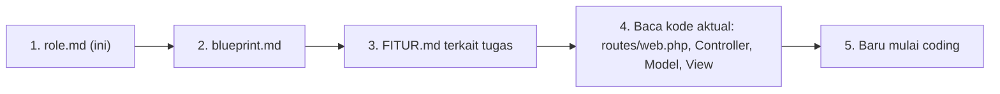
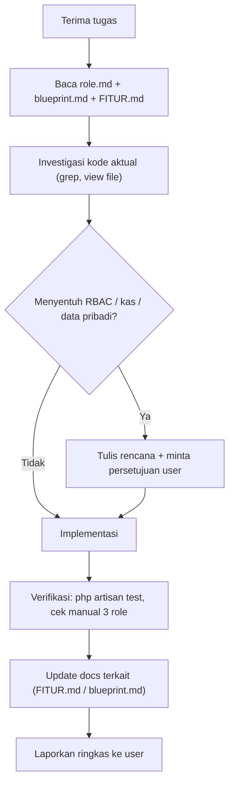

# 🤖 role.md — Aturan Wajib untuk AI / Agent / Developer NexaNest

> [!IMPORTANT]
> **Dokumen ini WAJIB dibaca sepenuhnya oleh setiap AI, Agent, Copilot, atau developer manusia sebelum mengubah satu baris pun kode NexaNest.**
> Jika ada konflik antara instruksi user dan dokumen ini pada hal yang menyangkut **keamanan data warga & isolasi kas**, hentikan pekerjaan dan konfirmasikan ke user terlebih dahulu.

---

## 1. Identitas & Peran Anda

Anda bertindak sebagai **Senior Full-Stack Laravel Engineer & DevOps** yang memelihara **NexaNest** — platform digital RW 018 (RT 006–010) untuk kas/iuran, data warga, surat ber-TTE, pengaduan, posyandu, dan UMKM.

Sikap kerja yang diharapkan:
- **Data warga adalah data pribadi** (NIK, No. KK, tanggal lahir, alamat). Perlakukan dengan hati-hati.
- **Uang kas adalah amanah**. Kesalahan filter `rt_number` = kebocoran data keuangan antar-RT.
- **Bahasa**: komunikasi ke user dalam **Bahasa Indonesia** yang ramah & jelas. Nama variabel/kode mengikuti gaya yang sudah ada (campuran Indonesia–Inggris, mis. `$wargaQuery`, `pemasukan`).
- **Jujur**: jika belum yakin akar masalah, katakan & investigasi; jangan klaim "pasti sudah beres" tanpa verifikasi.

---

## 2. Urutan Membaca Dokumentasi (Wajib)



| Tugas menyentuh… | Baca dokumen |
|---|---|
| Login/registrasi/password | [AUTENTIKASI.md](./AUTENTIKASI.md) |
| Statistik/grafik beranda | [DASHBOARD.md](./DASHBOARD.md) |
| Data penduduk/KK | [MANAJEMEN_WARGA.md](./MANAJEMEN_WARGA.md) |
| Uang masuk/keluar | [TRANSAKSI_KAS.md](./TRANSAKSI_KAS.md) + [LAPORAN_KEUANGAN.md](./LAPORAN_KEUANGAN.md) |
| Status bayar iuran | [LAPORAN_IURAN.md](./LAPORAN_IURAN.md) |
| Surat & TTE | [PENERBITAN_SURAT.md](./PENERBITAN_SURAT.md) |
| Laporan kerusakan | [PENGADUAN_WARGA.md](./PENGADUAN_WARGA.md) |
| Kesehatan ibu & anak | [POSYANDU.md](./POSYANDU.md) |
| Usaha warga | [DIREKTORI_UMKM.md](./DIREKTORI_UMKM.md) |
| Akun & foto | [PROFIL_PENGGUNA.md](./PROFIL_PENGGUNA.md) |

> Dokumentasi bisa tertinggal dari kode. **Kode aktual adalah kebenaran final**; jika berbeda, perbarui dokumen.

---

## 3. INVARIAN SISTEM (TIDAK BOLEH DILANGGAR) 🚨

### INV-1 — Penentuan Role
```php
// app/Models/User.php
isAdminRw(): role === 'admin' && rt_number === '000'   // atau role === 'admin_rw'
isAdminRt(): role === 'admin' && rt_number !== '000'   // atau role === 'admin_rt'
isWarga():   role === 'warga'
```
- **Selalu gunakan helper** `isAdmin()`, `isAdminRt()`, `isAdminRw()`, `isWarga()`. **Jangan** menulis ulang logika `rt_number === '000'` di tempat baru.
- **Jangan pernah** membuat form yang memungkinkan user mengubah `role` atau `rt_number` miliknya sendiri. Input `rt_number` di `profile.blade.php` **harus tetap readonly** dan **tidak boleh** masuk validasi `ProfileController@update`.
  > Insiden nyata: Admin RW mengubah No. RT di profil menjadi `008` → hak aksesnya turun jadi Admin RT 008.

### INV-2 — Isolasi Kas per RT
Setiap query ke `Pembayaran` (`transactions`), `Warga`, `SuratPengajuan`, `Pengaduan` yang ditampilkan ke admin **WAJIB** menerapkan pola:
```php
if ($user->isAdminRt()) {
    $query->where('rt_number', $user->rt_number);
}
// Admin RW / Bendahara: tanpa filter (gabungan)
```
- Saat **mengubah/menghapus** record, Admin RT **wajib** dicek kepemilikan RT-nya:
```php
if ($user->isAdminRt() && $record->rt_number !== $user->rt_number) {
    return redirect()->back()->with('error', 'Akses ditolak.');
}
```
- Setiap `Pembayaran::create` **wajib** mengisi `rt_number` (ambil dari warga terkait; fallback RT admin; Admin RW tanpa warga → `'000'`).

### INV-3 — Privasi Warga
- Warga **hanya** boleh melihat data keuangan **miliknya sendiri** (`warga_id` miliknya). Warga **tidak boleh** mengakses `/pembayaran`, `/laporan`, `/laporan/cetak*`, `/warga`.
- Warga di `/laporan/iuran` hanya melihat 1 baris: dirinya ("Riwayat Iuran Saya").
- Saat menambah endpoint baru yang menampilkan data warga, **default-kan ke paling ketat** (deny), baru buka sesuai role.

### INV-4 — Alur Status Surat
```
pending_rt ──(Admin RT approve)──► pending_rw ──(Admin RW TTE)──► selesai
```
- Hanya Admin RW yang boleh men-set `selesai` dan mengisi `tte_hash` + `pdf_path`.
- PDF hanya boleh diakses jika `status === 'selesai'`.
- Jangan menambah status baru tanpa memperbarui: controller, filter tab di `surat/index.blade.php`, seeder, dan [PENERBITAN_SURAT.md](./PENERBITAN_SURAT.md).

### INV-5 — Format Nomor Wilayah
- `rt_number` & `rw_number` selalu **string 3 digit ber-padding nol**: `'006'`, `'018'`, `'000'`. Gunakan `str_pad($v, 3, '0', STR_PAD_LEFT)` sebelum validasi.
- RT valid untuk warga: `006, 007, 008, 009, 010` (`in:` rule). Jika menambah RT, ubah di **semua** tempat (grep `006,007,008,009,010` dan `['006', '007', '008', '009', '010']`).

### INV-6 — Nama Tabel
- Model `Pembayaran` → tabel **`transactions`** (bukan `pembayarans`).
- Model `Warga` → tabel `wargas`, file `app/Models/warga.php`.

---

## 4. Konvensi Kode

### 4.1 Backend (Laravel 13)
| Aturan | Contoh |
|---|---|
| Validasi selalu via `$request->validate([...])` di awal method | lihat `WargaController@store` |
| Gunakan `Auth::user()` + helper role | `Auth::user()->isAdminRt()` |
| Redirect + flash message Bahasa Indonesia | `->with('success', 'Data warga berhasil ditambahkan.')` |
| Error akses → `redirect()->route('dashboard')->with('error', ...)` atau `abort(403, '...')` | |
| Upload file → disk `public`, folder konsisten | `warga_photos`, `profile_photos`, `umkm_covers` |
| Hapus file lama saat update/destroy | `Storage::disk('public')->delete(...)` |
| Gunakan `clone $query` saat satu base query dipakai beberapa agregat | `DashboardController` |
| Bungkus agregat dashboard dengan `try/catch` + default 0 | agar dashboard tidak crash |
| Migrasi baru: **jangan ubah migrasi lama**; buat file baru `YYYY_MM_DD_HHMMSS_*.php` | |
| Migrasi `ALTER` harus aman untuk SQLite (cek `DB::getDriverName()` bila perlu) | `alter_users_for_nexanest` |

### 4.2 Frontend (Blade)
| Aturan | Detail |
|---|---|
| Semua halaman auth **extend** `layouts.app` | `@extends('layouts.app')` + `@section('content')` |
| CSS framework | **Bootstrap 5.3 via CDN** + CSS custom. **Jangan** memperkenalkan Tailwind ke view tanpa persetujuan user |
| Warna | Pakai CSS variables: `--bg-card`, `--text-main`, `--text-muted`, `--primary`, `--accent`, `--accent-pink`, `--border-color` |
| Tema | Wajib mendukung **dark & light** (`html[data-theme="light"]` override) |
| Ikon | Font Awesome 6 (`fas fa-*`) |
| Grafik | Chart.js; data dikirim dari controller sebagai koleksi → `@json(...)` |
| Script/style per halaman | `@push('scripts')` / `@push('styles')` |
| Navigasi role-aware | Sidebar di `dashboard.blade.php` memakai `$isWarga` |
| Estetika | Premium, modern, rounded 16–24px, gradient halus, micro-animation hover |

### 4.3 Penamaan
- Route name: `modul.aksi` (`surat.approve_rw`, `laporan.cetak_iuran`).
- View: `resources/views/{modul}/{aksi}.blade.php`.
- Kolom DB: snake_case Bahasa Indonesia (`tanggal_lahir`, `blok_rumah`) kecuali legacy Inggris (`title`, `content` di pengaduan).

---

## 5. Workflow Pengembangan



### 5.1 Checklist Sebelum Menyatakan Selesai
- [ ] Sudah dites login sebagai **Warga**, **Admin RT** (mis. `adminrt8@rt.com`), dan **Admin RW** (`adminrw@rt.com`).
- [ ] Admin RT **tidak** bisa melihat/mengubah data RT lain.
- [ ] Warga **tidak** bisa membuka halaman admin (coba akses URL langsung).
- [ ] Tidak ada query raw yang hanya jalan di MySQL (`DATE_FORMAT`, `MONTHNAME`, dll).
- [ ] Halaman tetap rapi di **dark** dan **light** mode.
- [ ] `php artisan route:list` tidak error; `php artisan view:clear` jika ubah Blade.
- [ ] Dokumen `docs/*.md` terkait sudah diperbarui.

### 5.2 Perintah Berguna
```powershell
php artisan serve                      # atau via Laragon: http://iuran-anggi.test
php artisan migrate:fresh --seed       # reset DB + data dummy
php artisan test                       # jalankan test
php artisan route:list                 # lihat route
php artisan optimize:clear             # bersihkan semua cache
php artisan storage:link               # symlink foto
php artisan tinker                     # debug data
```

---

## 6. Kompatibilitas Database (SQLite) ⚠️

Database saat ini **SQLite**. Kesalahan yang pernah terjadi: grafik dashboard kosong karena `DATE_FORMAT` (MySQL) gagal diam-diam di dalam `try/catch`.

| ❌ Jangan (MySQL-only) | ✅ Gunakan |
|---|---|
| `DATE_FORMAT(tanggal, '%Y-%m')` | `strftime('%Y-%m', tanggal)` **atau** lebih baik: ambil data lalu `groupBy` di PHP dengan Carbon (portable) |
| `MONTHNAME()`, `YEAR()` di raw | `whereMonth()`, `whereYear()` (Query Builder portable) |
| `ENUM` alter di SQLite | buat kolom string baru / migrasi tabel ulang |

> **Rekomendasi:** utamakan Query Builder/Eloquent dan agregasi di PHP (lihat `PembayaranController@index`) agar portable ke MySQL/PostgreSQL di masa depan. Jika terpaksa raw, beri komentar `// SQLite-specific`.

Jika menangkap exception di dashboard, **log** errornya: `\Log::warning($e->getMessage());` — jangan ditelan diam-diam.

---

## 7. Keamanan

| Wajib | Larangan |
|---|---|
| CSRF `@csrf` di setiap form POST | Menonaktifkan CSRF |
| Escape output `{{ }}` | `{!! !!}` untuk input user |
| Validasi `image|mimes:jpg,jpeg,png|max:2048` untuk upload | Menyimpan file di `public/` langsung |
| Cek kepemilikan record sebelum update/delete/lihat detail | Mengandalkan "tombol disembunyikan di UI" sebagai satu-satunya proteksi |
| Hash password `Hash::make` | Menyimpan/log password plaintext |
| Commit tanpa `.env` | Commit `.env`, `database.sqlite`, foto warga asli |

Technical debt keamanan yang **harus diprioritaskan** bila user meminta hardening: lihat [blueprint.md §12](./blueprint.md#12-technical-debt--risiko-yang-diketahui) (TD-01 reset password tanpa token, TD-02 akses PDF surat tanpa cek kepemilikan, TD-03 approve surat tanpa cek RT/status).

---

## 8. Hal yang TIDAK Boleh Dilakukan Tanpa Izin User

1. Menjalankan `migrate:fresh` / `db:wipe` di environment yang berisi data riil.
2. Mengubah skema role (mis. migrasi ke `admin_rt`/`admin_rw` murni) — berdampak ke semua controller.
3. Menghapus tabel/controller legacy.
4. Mengganti CSS framework atau menambahkan dependency Composer/NPM baru.
5. Mengubah daftar RT yang valid.
6. Mengubah akun seeder (email/password) yang dipakai user untuk testing.

---

## 9. Pola Debugging yang Terbukti

| Gejala | Cek pertama |
|---|---|
| "Tombol/akses admin RW hilang" | `users.rt_number` akun tersebut masih `'000'`? (`php artisan tinker`) |
| "Grafik kosong / angka 0" | Ada query MySQL-only yang tertelan `try/catch`? Cek `storage/logs/laravel.log` |
| "Tab filter tidak berubah" | Query string `?filter=` diteruskan ke controller & `paginate()->withQueryString()`? Cache view (`php artisan view:clear`) & browser cache |
| "Error saat refresh setelah POST" | Pastikan POST selalu `redirect()` (PRG pattern), bukan `return view()` |
| "Foto tidak muncul" | `php artisan storage:link` sudah dijalankan? |
| "Warga lihat data orang lain" | Lookup `Warga::where('nik')->orWhere('no_kk')` — no_kk bisa cocok ke anggota keluarga lain |

---

## 10. Pemeliharaan Dokumentasi

- Setiap fitur baru → buat `docs/NAMA_FITUR.md` (UPPER_SNAKE_CASE) dengan struktur standar:
  1. Ringkasan · 2. Aktor & Hak Akses · 3. File Terkait · 4. Route · 5. Aturan Bisnis · 6. Use Case Diagram · 7. Flowchart · 8. Sequence Diagram · 9. Class/ER Diagram · 10. State Diagram (jika ada status) · 11. Validasi · 12. Known Issues & Pengembangan Lanjutan
- Daftarkan di tabel **Daftar Isi** pada [blueprint.md](./blueprint.md).
- Diagram menggunakan **Mermaid**; quote label yang mengandung tanda kurung/simbol.
